# INSPIRE 数据库入门与提取平台操作教程

> **一句话介绍**：这是一份写给"第一次用 INSPIRE 做围手术期研究"的人的中文教程。它不只告诉你点哪个按钮，更要让你明白**为什么是那个按钮**——尤其是几乎所有人第一次都会搞错的**分阶段**和**时间窗**。
>
> 平台入口：从门户 <https://www.zstats.cn/> 进入（不要收藏具体实例地址，见 [§5.3](#53-四个入口)）
> 教程编写：2026-09 · 全部内容来自对平台的**真实全流程操作**与对**导出数据的解析**
> 当前实测版本：**1.0.3**（见 [§5.0 版本适配说明](#50-版本适配说明先读这一节)）

---

## 写在前面

### 这份教程写给谁

- 麻醉科、外科、ICU 的临床医生和研究生，想用围手术期大数据发一篇文章，但没系统做过公开数据库；
- 会用 R / SPSS，但被 INSPIRE 的"同一个变量出现五次""时间全是分钟数"搞懵的人；
- 已经用过这个平台，照着别人的步骤点出了一份数据，但**说不清自己每一步在做什么**的人。

### 学完你能做到

1. 说清楚 INSPIRE 的数据是怎么组织起来的，以及它为什么必须"分阶段"；
2. 独立写出一个完整的时间窗定义，比如"术前 24 小时内最后一次白蛋白"；
3. 从头到尾跑完一次规范提取：选变量 → 定暴露/协变量/结局 → 载入数据 → 整理 → 纳排 → 下载；
4. 看懂导出数据里那些中文列名，知道每个 `_time` 列在说什么；
5. 避开 30 多个实测踩过的坑（含 3 个平台自身的 bug 和跨版本行为变化）。

### 建议的阅读方式

- **赶时间**：直接跳到[第五章](#第五章-平台全景与登录)，一边对着平台一边往下看，遇到不懂的再回查前面。
- **想学明白**：老老实实按顺序读。第一章到第四章是地基，**读完这四章再去操作，能省下大量返工时间**。
- **只想抄作业**：直接看[第十一章 完整实战](#第十一章-完整实战从零到一份可发表的数据)。

> 🔬 教程里带 🔬 标记的都是**真实实测数字**，不是估的。所有数字来自本教程编写时对平台的真实操作、以及对导出字段的逐列核对。

---

# 第一部分 先搞懂数据

## 第一章 五分钟认识 INSPIRE

### 1.1 它是什么

**INSPIRE** 全称 *INformative Surgical Patient dataset for Innovative Research Environment*，是**韩国首尔国立大学医院（SNUH）**公开的一套围手术期数据集，由 Hyung-Chul Lee 和 Leerang Lim 整理，2023 年 10 月发布 1.0 版，托管在 PhysioNet 上。

| 项目 | 内容 |
|---|---|
| 来源 | 韩国首尔国立大学医院（**单中心**） |
| 时间跨度 | 2011 年 1 月 – 2020 年 12 月 |
| 规模 | 约 **13 万例手术**（占该院同期全部手术的 50%，随机抽取后公开） |
| 纳入 | 接受全身麻醉、椎管内麻醉、区域麻醉、监护麻醉（MAC）的全部患者 |
| 排除 | 手术日年龄 < 18 岁或 > 90 岁；拒绝公开入院信息者；媒体报道过者 |
| 访问 | 需要 PhysioNet 资质认证 + 签署数据使用协议 |
| 引用 | Lee H, Lim L. *INSPIRE* (version 1.0). PhysioNet. 2023. DOI: 10.13026/jyzb-ez61 |

### 1.2 它和 MIMIC、NHANES 有什么不一样

| 对比项 | MIMIC-IV | NHANES | **INSPIRE** |
|---|---|---|---|
| 人群 | ICU 危重症 | 美国普通人群 | **手术患者** |
| 分析单元 | 一次住院（hadm_id） | 一个人 | **一台手术（op_id）** |
| 时间结构 | 绝对时间戳 | 横断面，无时间轴 | **相对分钟 + 固定阶段划分** |
| 核心难点 | 事件表关联 | 权重 | **"同一个变量测了好多次，取哪一次"** |
| 有没有现成提取平台 | 没有（自己写 SQL） | 有 | **有（本教程讲的这个）** |

**INSPIRE 的独特之处，是它自带一条"围手术期时间线"。** 每台手术都有明确的几个锚点：入院 → 入手术室 → 切皮 → 关腹 → 出手术室 → 出院。这条线是围手术期研究的骨架，也是 INSPIRE 最值钱的地方。

### 1.3 一份数据长什么样

官方给了 6 张表（外加 2 个说明文件）：

| 表 | 内容 | 关键列 |
|---|---|---|
| `operations` | 手术主表：人口学、手术与麻醉时间、诊断手术码、麻醉类型、ICU 入出、死亡 | `op_id, subject_id, hadm_id, opdate, ..._time, icd10_pcs, antype, emop, asa` |
| `diagnosis` | 诊断长表，ICD-10-CM **只保留前 3 位** | `subject_id, chart_time, icd10_cm` |
| `labs` | 化验长表 | `subject_id, chart_time, item_name, value` |
| `medications` | 用药长表 | `subject_id, chart_time, route, drug_name, atc_code` |
| `vitals` | **术中**生命体征与麻醉机参数 | `op_id, subject_id, chart_time, item_name, value` |
| `ward_vitals` | **非手术室**（ICU / 普通病房）生命体征 | `subject_id, chart_time, item_name, value` |
| `schema.csv` | 变量字典 | — |
| `parameters.csv` | vitals / ward_vitals / labs 的参数标签 | — |

表之间靠 ID 关联：

```
subject_id（患者，以 1 开头）
   └── hadm_id（住院，以 2 开头） 一个患者可以多次住院
          └── op_id（手术，以 4 开头） 一次住院可以多台手术
```

`diagnosis` / `labs` / `medications` / `ward_vitals` 只能定位到**患者**级别，`vitals` 能定位到**手术**级别。这个差别在做研究时会直接影响你能问什么问题。

### 1.4 时间是怎么记的

这是 INSPIRE 最关键、也最容易看错的一点：

- **所有 `_time` 结尾的列都是"分钟"，而且是一个相对偏移量，不是日期。**
- 官方定义：每位患者在数据集内的**首次入院手术时刻**设为 **time zero**，其余时间点全部转成相对 time zero 的分钟数。
- 🔬 实测补充：手术表里每位患者的**最早一条记录，`admission_time` 都是 0**（130,960 条手术里患者首条记录 100% 为 0）；同一患者的再次入院会给出更大的正数，比如 4,320（第 3 天）、10,080（第 7 天）、2,126,880（约 4 年后）。
  → 实操上可以简单理解为：**每位患者的首次入院 = 0 点，数字越大越晚。**
- 数据是**聚合过的**：生命体征和化验结果已按**中位数**汇总，最大分辨率 **5 分钟**（`chart_time` 落在 5 分钟网格上）。
- 原始采样频率：术中麻醉记录约每 1 分钟一条；ICU 每小时或按医嘱；普通病房每天 4–6 次。

**所以你在平台上看到的 4.4、−225 这样的数字，意思是"白蛋白 4.4 g/dL，发生在 −225 分钟"。**

### 1.5 几个先记住的数字

| 数字 | 含义 | 来源 |
|---|---|---|
| **130,946** | 平台最终数据集的固定行数 = 纳入分析的手术台数 | 🔬 平台实测 |
| **9,793** | 全人群版变量字典条目数 | 🔬 平台实测 |
| **14,157** | 术后入 ICU 的手术台数（`has_postop_icu=1`） | 🔬 数据核验 |
| **12,356** | 术后入 ICU 的患者数 | 🔬 数据核验 |
| **20** | 变量购物车上限 | 平台界面原文 |

### 1.6 平台在这一套体系里的位置

```
        INSPIRE 原始数据（PhysioNet，6 张长表）
                │
                │  传统做法：自己写 SQL / R 关联、切时间窗，耗时长且极易出错
                ▼
   ┌──────────────────────────────────┐
   │  ZSTATS · INSPIRE 数据提取平台     │  ← 本教程讲的平台
   │  · 已把 6 张长表整理成手术级宽表   │
   │  · 变量按"表 × 阶段"预先展开       │
   │  · 时间窗、提取方式可视化配置      │
   │  · 纳排 + 自动画流程图             │
   │  · 直接导出 Excel / SPSS           │
   └──────────────────────────────────┘
                │
                ▼
        一份可以直接进 R / SPSS 的宽表
```

**平台真正替你省掉的，是"把长表按时间窗折叠成宽表"这件又琐碎又容易错的事。**

但请注意：**平台能帮你把数据摆整齐，不能替你决定暴露怎么定义、窗口开多大。** 那正是第二章、第三章要解决的问题。

---

## 第二章 分阶段：INSPIRE 最容易被忽略的设计

### 2.1 一个让人抓狂的问题

你打算研究"术前白蛋白和术后死亡的关系"，于是在平台里搜"白蛋白"。

然后你会看到这个：

```
实验室检查表 | 入院前       | albumin
实验室检查表 | 入院到手术开始 | albumin
实验室检查表 | 手术期间      | albumin
实验室检查表 | 手术结束到出院 | albumin
```

**四个 albumin。** 再加上术中输液用的 `alb5` / `alb20`，一共十条。

第一次到这儿的反应基本都是：*这是重复数据吗？随便勾一个行不行？*

不行。**这四条是同一个指标在四个不同时间段的取值，是四个不同的变量。** 勾错一条，你的"术前白蛋白"可能会变成"术后白蛋白"。

### 2.2 为什么要这么设计

想象一位 60 岁患者的一次住院：

```
入院 ──┬── 术前 3 天  白蛋白 32
       ├── 术前 1 天  白蛋白 31      ← 你想要的"术前状态"
       ├── 切皮
       ├── 术中 2 小时 白蛋白 28      ← 这是手术打击造成的，不能当基线
       ├── 术后 1 天  白蛋白 30
       ├── 术后 5 天  白蛋白 29
       └── 出院
```

如果你只跟程序说"取白蛋白"，程序只能给你平均值（没意义）、或者最后一次（可能是出院前的），或者随机一次。

**围手术期研究里，"什么时候测的"和"测出来多少"一样重要。** 所以 INSPIRE 的做法是：先把时间轴切成固定的几段，再把指标按段展开。

这个"段"，平台叫**阶段**（英文标签 `stage` / `segment_name`）。

### 2.3 五个阶段，一张图

平台"请选择暴露的阶段"有 5 个单选项：

```
                    ┌──── 入院前 ────┐┌─ 入院到手术开始 ─┐┌── 手术期间 ──┐┌─ 手术结束到出院 ─┐┌─ 出院后 ─┐
时间轴  ────────────●────────────────●─────────────────●──────────────●───────────────────●──────────→
                  入院             入手术室           切皮           关腹/出手术室        出院
                  (admission)      (orin_time)      (opstart)       (opend)          (discharge)
```

| 阶段（平台中文） | 英文标签 | 区间 | 这里面主要有什么 |
|---|---|---|---|
| 基线特征 | — | 手术当次的一条 | 年龄、性别、体重、身高、ASA、急诊标志、科室、麻醉类型 |
| 入院前 | `pre_admission` | 入院之前 | 既往诊断（ICD-10-CM）、院前用药 |
| 入院到手术开始 | `admission_to_opstart` | 入院 → 入手术室 | 术前化验、术前用药、术前生命体征 |
| 手术期间 | `opstart_to_opend` | 切皮 → 关腹 | 术中生命体征、麻醉药、血管活性药、输液输血、尿量、失血 |
| 手术结束到出院 | `opend_to_discharge` | 关腹 → 出院 | 术后化验、术后用药、病房/ICU 生命体征、并发症 |
| 出院后 | `post_discharge` | 出院之后 | 远期并发症、全因死亡、再入院 |

🔬 变量字典里各阶段的条目数（全人群版 9,793 条）：

| 阶段 | 条目数 |
|---|---|
| 手术期间 | 2,881 |
| 手术结束到出院 | 1,861 |
| 入院到手术开始 | 1,789 |
| 入院前 | 1,691 |
| 出院后 | 1,563 |
| 基线特征 | 8 |

"手术期间"最多，因为术中生命体征和麻醉用药是逐分钟记录的，变量最密。

### 2.4 分阶段给你带来的三件事

**第一件：一条诊断码会变成五条。**

INSPIRE 的 `diagnosis` 表里有 1,138 个 ICD-10-CM 前 3 位码。乘上阶段，就变成 4,032 条变量条目。这是 9,793 这个数字的主要来源：

| 表单 | 条目数 |
|---|---|
| 诊断表 | 4,032 |
| 药物表 | 2,974 |
| 手术表 | 2,288 |
| 术中生命体征表 | 256 |
| 实验室检查表 | 190 |
| 病房生命体征表 | 45 |
| 基线表 | 8 |

**第二件："术前合并症"必须用两段并集。**

很多研究会写"术前合并高血压"。但一个高血压诊断可能记在**入院前**（患者早就有的），也可能记在**入院到手术开始**（这次住院才下的诊断）。

只取一段 → 会漏人。
正确做法：`入院前` ∪ `入院到手术开始`。

**第三件：阶段顺序 = 因果顺序，平台用它来卡住你的设计。**

这一点在第七章细说，先记住结论：

| 角色 | 能在哪些阶段取 |
|---|---|
| 暴露 | **只能在你选定的那一个阶段** |
| 协变量 | 暴露阶段**及其之前** |
| 结局 | 暴露阶段**及其之后**（含同一阶段、含出院后） |

### 2.5 ICU 研究怎么办：不是 5 段，是 7 段

平台首页挂的是**全人群版（5 阶段）**。如果你要做 ICU 研究，需要知道 INSPIRE 的 ICU 子集用的是 **7 阶段**，把"手术结束到出院"拆成了三段：

```
入院前 → 入院到手术开始 → 手术期间
      → 手术结束到ICU入科   (opend_to_icuin)     ← 新增
      → ICU期间            (postop_icu)         ← 新增
      → ICU出科到出院       (icuout_to_discharge) ← 新增
      → 出院后
```

🔬 实测：ICU 版变量字典 8,527 条，各阶段分布为 ICU出科到出院 1,515 / 入院到手术开始 1,406 / 入院前 1,199 / ICU期间 1,193 / 手术期间 1,129 / 出院后 1,114 / 手术结束到ICU入科 963 / 基线特征 8。

**但即使用 5 阶段的全人群版，也完全能做 ICU 研究**——因为基线表已经把 ICU 信息给你了：

| 列名 | 含义 |
|---|---|
| `has_postop_icu` | 是否术后入 ICU（`1` = 是）🔬 14,157 台 |
| `icu_overlap_type` | ICU 重合类型（0=不入 / 1=术后常规入 / 2=术后非预期） |
| `is_first_icu` | 是否首次入 ICU |
| `icuin_time` / `icuout_time` | 入/出 ICU 时间（分钟） |

比如"术后非预期入 ICU"作为结局，直接用 `icu_overlap_type == 2` 就行，不必去变量字典里捞。

### 2.6 这一章要记住的一句话

> **平台里的每一个"变量"，其实都是"某张表的某个指标 × 某个时间阶段"。勾选时永远先看"时间阶段标签"那一列。**

---

## 第三章 时间窗：术前白蛋白到底取哪一次

分阶段解决了"大概在哪一段"，但还没解决"段里面的哪一次"。

一位患者入院到手术开始可能有 3 次白蛋白：入院时 32、术前 1 天 31、术前 6 小时 30。**你还要告诉平台取哪一次。**

这就是**时间窗**。

### 3.1 时间窗长什么样

在第二步（变量整合）里，每个规则组都有一组参数。平台界面原文是：

```
设置规则组 1 的时间窗              是 / 否
规则组 1 允许变量发生在哪个阶段      以 阶段终点 为锚点，向前取 t 分钟
请输入时间 t，单位为分钟
规则组 1 的提取方式                首次 / 末次 / 均值 / 中位数 / 最大值 / 最小值
```

翻译成人话：

```
在"这个阶段的终点"往前数 t 分钟，画一个框；
把框里这个变量的所有记录挑出来；
按"提取方式"归约成一个数。
```

写成式子：

```
候选 = { 记录 | 记录属于该阶段 且 阶段终点 − t ≤ 记录时间 ≤ 阶段终点 }
结果 = 归约(候选, 提取方式)
```

底下"对变量进行处理"的汇总表会把内部参数原样抖出来，**这是核对设置有没有生效的最好地方**：

| 表单 | 时间范围标签 | 变量名 | method | 起始时间 | 终点时间 | 跨阶段 | 变量类型 |
|---|---|---|---|---|---|---|---|
| 实验室检查表 | 入院前 | albumin | 末次 | `segment_end - 1440` | `segment_end` | 不跨阶段 | 定量暴露 |
| 诊断表 | 手术结束到出院 | death in hospital | 首次 | `segment_end - 10080` | `segment_end` | 不跨阶段 | 分类结局 |

`segment_start` / `segment_end` 就是阶段的起止边界（单位同样是分钟）。

### 3.2 举个例子把时间窗焊死

目标：**术前 24 小时内最后一次白蛋白**（也就是很多论文里写的"术前最近一次"）。

```
第一步：选暴露阶段 = 入院前（或入院到手术开始，看你研究设计）
第二步：增加一组"定量暴露"
        变量 = albumin
        时间窗 = 是
        t = 1440           ← 1440 分钟 = 24 小时
        提取方式 = 末次     ← 取最靠近手术的那一次
```

于是平台内部就是：

```
[segment_end − 1440, segment_end] 内，albumin 的"最后一次"取值
```

### 3.3 t 该填多少

t 的单位是**分钟**，常用换算：

| 你想要的窗口 | t 填 |
|---|---|
| 术前 6 小时 | 360 |
| 术前 12 小时 | 720 |
| 术前 24 小时（1 天） | 1440 |
| 术前 48 小时（2 天） | 2880 |
| 术前 3 天 | 4320 |
| 术前 7 天 | 10080 |
| 术前 30 天 | 43200 |

**注意：t 必须大于 0。** 留空或填 0，界面会提示"请设置一个大于 0 的时间"，或者窗口为空导致整列缺失。

### 3.4 六种提取方式怎么选

| 提取方式 | 在做什么 | 什么时候用 |
|---|---|---|
| **首次** | 窗内最早的一次 | 结局事件（首次发生的那一次）、基线状态 |
| **末次** | 窗内最晚的一次 | **术前指标最常用**，离手术最近最贴近术前真实状态 |
| 均值 | 窗内所有值的平均 | 术中血流动力学（如平均动脉压） |
| 中位数 | 窗内所有值的中位数 | 波动大、有极端值的指标（如血糖） |
| 最大值 | 窗内最大值 | 术中最高体温、峰值乳酸 |
| 最小值 | 窗内最小值 | 术中最低 SpO₂、最低血红蛋白、最低血压 |

分类变量（诊断、药物、器械使用）只有三种：**首次 / 末次 / 任意一次**。
"**任意一次**"的意思就是"这个阶段里出现过就算"，做"**结局**"时用它（"术后是否发生某并发症"）。

> 🔴 **但有一个例外必须记住：「任意一次」不能用在分类【暴露】上——会导致「载入最终数据」直接失败。**
> 分类暴露请用 **首次 / 末次**。详见 [§3.8](#38-五个反面教材) 反面教材 5。

### 3.5 跨阶段时间窗

协变量和结局的规则组会多一个开关：

```
规则组 1 允许变量跨阶段    是（跨阶段的时间窗） / 否（本阶段的时间窗）
```

- **否**（默认）：只在本阶段里找，语义最干净；
- **是**：允许跨相邻阶段找记录。

什么时候需要"是"？举个真实的麻烦：**术后死亡**这个诊断，可能被记在"手术期间"，也可能被记在"手术结束到出院"。你如果固定在某一个阶段，就会漏掉另一批人。这时把"允许变量跨阶段"打开。

**但能不开就别开。** 跨阶段会让窗口边界变模糊，审稿人问起来不好解释。

### 3.6 暴露 / 协变量 / 结局的取数规则

这是整个平台最核心的规则，界面会随你选的暴露阶段实时提示你：

| 角色 | 可选阶段 | 平台原文提示 |
|---|---|---|
| **暴露** | 你在第一步声明的**那一个**阶段 | "当前暴露变量选择阶段为：入院前 / 暴露变量仅从'入院前'阶段中选择。" |
| **协变量** | 暴露阶段**及其之前** | "当前协变量可选择的阶段为(暴露及之前的阶段)：入院前" |
| **结局** | 暴露阶段**及其之后**（含同一阶段、含出院后） | "当前结局变量可选择的阶段为：入院前 / 入院到手术开始 / 手术期间 / 手术结束到出院 / 出院后" ⚠️ 这句提示会**列出全部 5 个阶段**，但实际可选范围是受限的，见下方说明 |

还有一条限制：

> 此外，还可以选择当前暴露阶段"入院前"中未被暴露变量和协变量使用的变量。

也就是说，暴露阶段里"用剩下"的变量可以拿去当结局，但**不能同一个变量既当暴露又当结局**。

#### ⚠️ 结局不能取「早于暴露阶段」的阶段

**别被那句提示误导。** 结局面板顶部写的是"可选择的阶段为：入院前 / 入院到手术开始 / 手术期间 / 手术结束到出院 / 出院后"——**五个阶段全列出来了**，看着像任意阶段都能选。**实际上：**

> **结局阶段不得早于暴露阶段。** 可选范围是 **暴露阶段 及 其之后**。

🔬 实测（1.0.3.x2 版，2026-10）：

| 暴露阶段 | 结局阶段 | 相对关系 | 结果 |
|---|---|---|---|
| 手术结束到出院 | 手术结束到出院 | 同一阶段 | ✅ 可选 |
| 入院前 | 入院到手术开始 / 手术期间 / 手术结束到出院 / 出院后 | 更晚 | ✅ 全部可选 |
| **出院后** | **手术结束到出院** | **更早** | ❌ **结局面板的变量下拉根本没渲染出来，规则组建不起来** |

最后一行就是踩坑现场：把暴露阶段设成"出院后"之后，想回头选一个"手术结束到出院"的结局，**下拉框是空的**——不是你没找到，是平台不让选。

**为什么这么设计？** 和"暴露必须在结局之前"是同一个道理的延伸：结局是随访期内发生的事，随访从暴露开始算，那么在暴露之前就已经发生的结局没法归因给暴露。**这个限制是合理的，只是提示文案没跟上。**

**实操建议**：

- 如果你的结局事件发生在早期阶段（比如术中并发症）、而暴露在晚期阶段（比如术后用药），**这个设计会直接卡住你**。解决办法是把暴露往前挪到结局之前，或者改用基线表里现成的结局列（如 `is_inhosp_death`、`has_postop_icu`）；
- 配好规则组后，**一定要回头看一眼结局的变量下拉里到底有没有你想要的阶段**——不要只看提示文字。

**为什么这么设计？** 因为暴露必须在结局之前发生。如果允许暴露取"出院后"阶段的变量，逻辑上就倒过来了。平台用阶段的先后硬性堵住了这个错误——这是个很贴心的设计，也是你用别的工具容易犯的错。

### 3.7 随访起点与随访终点：生存分析的两端

结局面板顶部还有一个关键选项：

```
选择随访起点
  ● 以暴露时间作为起始点（多暴露以末次暴露时间为起点）
  ○ 以特定时间点作为起始点（以暴露所在阶段的终点为最早可选起点）
```

这决定了**生存分析的 t=0 在哪儿**：

| 选项 | 内部值 | 说明 |
|---|---|---|
| 以暴露时间为起点 | `last_time` | 暴露测完的那一刻开始算随访。多暴露时以最后一次暴露为准 |
| 以特定时间点为起点 | `spe_time` | 以暴露所在阶段的终点为最早可选起点 |

选第一种时，平台会**多输出一列** `cohort_start_time`。

🔬 实测：`cohort_start_time` 的数值等于暴露变量的 `_time`。上面例子里白蛋白的 `_time = −225`，`cohort_start_time` 也是 `−225`。

做 Cox 回归时你有两种用法：

```r
# 用平台算好的随访时长
Surv(follow_time / 1440, event)

# 或者自己算
Surv((event_time - cohort_start_time) / 1440, event)
```

#### 随访终点：没发生事件的人，算到哪一刻被删失

**这一节是很多人生存分析做错的根源，务必看懂。**

一个关键事实：**没发生事件的人，结局列是 `0`，但它的 `_time` 不是缺失——平台替你填了一个"删失时间"。** 这个时间填在哪儿，决定了你的 KM 曲线和 Cox 结果。

🔬 实测：平台**先按结局类型分两套规则**，**再按「时间窗」是否开启分两支**，一共三种落点：

| 结局类型 | 时间窗 | 未发生事件者的 `_time` 落在 | 实测吻合率 |
|---|---|---|---|
| **手术类结局**（例：`手术表_手术期间_0FB00_首次`） | **否** | **出院时间 `discharge_time`** | **100%（130,274 / 130,274）** |
| **其它事件类结局**（例：`药物表_手术期间_cefazolin_首次`） | **否** | **该阶段的截止时间**（此例 = 手术结束 `opend_time`） | **100%（127,197 / 127,197）** |
| **设了时间窗 t 的结局**（实测：分类结局 AKI，阶段 = 手术结束到出院，t = 10080） | **是** | **窗口终点 = 阶段起点 + t**（此例 = `opend_time + 10080`） | **100%**（0 值行全部吻合） |

同时实测确认：

- **发生事件者**的 `_time` = 真实事件时间。例：0FB00 判 1 的 672 台，`_time == opstart_time` 占 **100%**；
- **`follow_time = _time − cohort_start_time`** —— 172 / 172 精确成立；
- 随访终点（`cohort_start_time + follow_time`）在未发生者上 == `discharge_time`，吻合率 **100%**（**此条只对「时间窗 = 否」成立**，见下）。

#### ⚠️ 分支：一设时间窗 t，截尾点就前移到窗口终点

上面"随访至阶段截止"的说法**只对「时间窗 = 否」成立**。只要给结局设了 t，未发生者的截尾点立刻被换成窗口终点：

```
时间窗 = 否          →  未发生者截尾于「阶段截止」（手术类=出院，其它=阶段结束）
时间窗 = 是，分类结局  →  未发生者截尾于「阶段起点 + t」   ← 截尾点前移
时间窗 = 是，定量结局  →  未发生者截尾于「阶段终点 − t」   ← 截尾点前移
```

> 注：定量结局的锚点是 `segment_end − t`，与分类结局方向相反；其截尾落点尚未单独实测，写入论文前按下面的语句核一遍。

**这会直接引爆一个矛盾。** 随访起点（`cohort_start_time`）实测约等于**出院时间**，而设 t 后随访终点是**手术结束 + t**。只要住院时间超过 t，终点就早于起点：

- 实测 t = 10080（7 天）时，130,946 行里有 **33,657 行（25.7%）的 `follow_time` 为负**；
- 最小值 **−5,358,945 分钟（约 −3722 天）**；
- `Surv(follow_time, event)` 会直接报错或给出完全错误的结果，KM 曲线和 Cox 模型全部不可用。

**规避办法（二选一）**：

1. **把结局的「时间窗」设为「否」**（取整个阶段）——截尾点回到阶段截止（出院），不会再出现负值。做"住院期间是否发生"这类结局时**推荐这种做法**；
2. 非要设窗，就把 **t 设得比最长住院时长大**（本例需 > 约 3700 天）——实际上等于放弃设窗。

> 🧭 **口诀**：拿到数据先跑一句 `min(follow_time)`。是负数，就说明结局窗口比住院时长短，必须回去改配置。

**为什么必须分清这几套规则？** 因为人的直觉是"没做手术的人随访到出院""没用药的人随访到出院"——**错**。后者只随访到**出手术室**（阶段截止）。拿它当终点做 KM 曲线，等于把术后那段时间凭空砍掉，事件率和中位生存时间都会算歪。

**建议：拿到数据后先跑这一句确认。**

```r
# 找一个分类结局，看它的 0 值台 _time 落在哪一列
d[结局列 == 0, .(n = .N,
    等于出院时间   = mean(get(paste0(结局列, "_time")) == discharge_time,     na.rm = TRUE),
    等于手术结束   = mean(get(paste0(结局列, "_time")) == opend_time,         na.rm = TRUE),
    等于阶段起点+t = mean(get(paste0(结局列, "_time")) == opend_time + 10080, na.rm = TRUE))]

# 设了 t 的话，再补一句——必须是正数
cat("follow_time 最小值 =", min(d$follow_time, na.rm = TRUE), "\n")
```

**写方法学段落时要用对措辞**（按实际设置二选一）：

> **（时间窗 = 否）** 手术类结局的未发生者，随访至出院（`discharge_time`）删失；非手术类结局的未发生者，随访至该阶段截止时刻删失。
>
> **（结局设了时间窗 t）** 非手术类结局的未发生者，随访至随访窗口终点（阶段起点后 t 分钟）删失；手术类结局设窗后的落点未单独实测，写入前先按上面的语句核一遍。

### 3.8 五个反面教材

**反面教材 1：术前指标用"首次"**

```
入院时  白蛋白 32   ← "首次"取到这里
术前1天 白蛋白 31
术前6h  白蛋白 30
```

你研究的是"术前营养状态对预后的影响"，结果取的是入院当天的值，包含了整个住院前期治疗的影响。**用"末次"。**

**反面教材 2：t 开得太大**

术前指标填 `t = 43200`（30 天），窗口直接从入院横跨到切皮——把入院时的化验也算进来了。术前窗口一般 **24 小时**，最多 **7 天**。

**反面教材 3：术中血压用"末次"**

"末次"只能拿到关腹前那一瞬间的血压值。研究术中低血压，应该用**均值**（或"最小值"看最低点）。

**反面教材 4：结局用"均值"**

二分类结局根本没有均值可言。分类结局请用 首次 / 末次 / 任意一次。

**反面教材 5：分类暴露用"任意一次"** 🔴

```
分类暴露 + 提取方式 = 任意一次   →  「载入最终数据」直接失败
```

🔬 实测：这条会让第二步的「🚀 载入最终数据」报错——而报错文案是 Shiny 的兜底句，**完全看不出原因**：

```
An error has occurred. Check your logs or contact the app author for clarification.
```

**7 组对照实验的结论**：

| 暴露 | 暴露的提取方式 | 结局 | 结果 |
|---|---|---|---|
| 定量 albumin | 末次 | 分类 0FB00 | ✅ |
| 定量 albumin | 末次 | 分类 cefazolin | ✅ |
| 定量 albumin | 末次 | 分类 0FB00（+ 分类**协变量**用任意一次） | ✅ |
| **分类 I10** | **首次** | 分类 0FB00 | ✅ |
| 分类 I10 | **任意一次** | 分类 0FB00（+ 协变量） | ❌ |
| 分类 I10 | **任意一次** | 分类 0FB00 | ❌ |
| 分类 I10 | **任意一次** | **定量 hb** | ❌ |

三条要点：

1. **分类暴露 + 分类结局本身完全正常**（上表第 4 行）——不要误以为是"分类配分类"的问题；
2. **触发条件是「分类暴露 × 任意一次」**，与结局是分类还是定量**无关**；
3. **「任意一次」用在协变量上没问题**（上表第 3 行）。所以是"分类暴露"这一个位置上的特定问题。

**怎么绕**：

- 分类暴露的提取方式改用 **首次** 或 **末次**（推荐，最简单）；
- 确实需要"任意一次"的语义时，把该变量从暴露挪到**协变量**侧；
- 失败后**先刷新页面**再重试——失败状态下会话可能已经不可用。

> 这是一个应该反馈给平台方的 bug。在它修好之前，把它当成一条硬性约束记住。

---

## 第四章 变量字典：9793 个变量是怎么来的

### 4.1 一个乘法

```
变量字典条目数 = 表单 × 阶段 × 变量
```

变量列表有 **9 列**：**表单 / 时间阶段标签 / 变量名 / 描述英文 / 描述中文 / 手术例数 / 记录条数 / 患者数**（后三列为更新后新增，见 [§6.5](#65-变量列表怎么读)）。🔬 全人群版共 **9,793 行**，翻页共 980 页（每页 10 行）。

同一个变量在不同阶段出现多次，是**正常现象**，不是重复数据。

### 4.2 六张表单分别在说什么

| 表单 | 内容 | 条目数 |
|---|---|---|
| 诊断表 | ICD-10-CM **前 3 位**诊断码（1,138 个） | 4,032 |
| 药物表 | 877 种药物通用名 + 给药途径 + ATC 分类 | 2,974 |
| 手术表 | ICD-10-PCS 手术操作码 | 2,288 |
| 术中生命体征表 | 73 项术中参数（含麻醉药、血管活性药、输液输血、呼吸机参数） | 256 |
| 实验室检查表 | 38 项检验 | 190 |
| 病房生命体征表 | 16 项病房/ICU 参数 | 45 |
| 基线表 | 8 个基线特征变量 | 8 |

几个实测的数量细节：

- **化验 38 项**：血常规（hb/hct/wbc/platelet）、生化（glucose/creatinine/bun/电解质/肝功能/白蛋白）、凝血（aptt/ptinr/fibrinogen/d_dimer）、血气（ph/pao2/paco2/lactate）、心肌（ck/ckmb/troponin）、炎症（crp）、hba1c 等；
- **术中参数 73 项**：心率、血压（有创/无创）、SpO₂、EtCO₂、体温、潮气量、气道压、PEEP、麻醉气体浓度、BIS、阿片类与血管活性药用量、输液输血量、尿量、失血量、ST 段等；
- **病房参数 16 项**：心率、无创血压、呼吸、体温、SpO₂、FiO₂、尿量、是否机械通气、GCS 三项、CRRT/ECMO/IABP 标志、有创血压。

### 4.3 基线表是强制的

平台在变量列表上方写得很清楚：

> **基线表变量必选，即使不选，系统默认全部提取**

🔬 实测：不管你购物车里选了什么，最终数据集的前 33 列永远是基线表的全部列，一列不少。

这 33 列 = 27 个原始列 + 6 个衍生结局列。其中 6 个衍生结局列**可以直接当结局变量用**：

| 列名 | 含义 |
|---|---|
| `is_inhosp_death` | 院内死亡（0/1） |
| `is_first_admission` | 是否首次入院 |
| `is_first_surgery` | 是否首次手术 |
| `is_first_icu` | 是否首次入 ICU |
| `icu_overlap_type` | ICU 重合类型 |
| `has_postop_icu` | 是否术后入 ICU |

再加时间列：`inhosp_death_time`、`allcause_death_time`、`icuin_time`、`icuout_time`、`admission_time`、`discharge_time`、`opstart_time`、`opend_time`……

**"患者死了没有、什么时候死的""进 ICU 没有、什么时候进的"这类问题，不用去变量字典里搜，基线表直接就给了。**

### 4.4 变量可得率：做样本量估算之前先看这个

不是每台手术都有每类记录。🔬 各表实际覆盖的手术台数（分母 130,946）：

| 表 | 覆盖手术台数 | 覆盖率 |
|---|---|---|
| 手术表 | 130,946 | 100% |
| 术中生命体征表 | 130,915 | 99.98% |
| 药物表 | 130,796 | 99.9% |
| 病房生命体征表 | 129,315 | 98.8% |
| 实验室检查表 | 128,775 | 98.3% |
| 诊断表 | 125,971 | 96.2% |

**你的样本量上限，是被你选的那个变量卡的。**

比如"术前白蛋白"这个变量，它不是每台手术都有值。真实可用样本量可能在几万到十几万之间。

#### 🆕 好消息：样本量现在不用跑统计，首页直接给

**第一步「数据查询」的变量列表现有 9 列**，最后三列就是现成的统计量：

| 列 | 含义 |
|---|---|
| **手术例数** | 该阶段有该变量的**手术台次**（去重）——**这就是你的样本量上限** |
| **记录条数** | 该阶段该变量的**总记录条数**（一台手术可能对应多条记录） |
| **患者数** | **患者**去重数（同一患者做多次手术只算一次） |

🔬 实测 `I10`（原发性高血压）在首页的显示：

| 表单 | 阶段 | 手术例数 | 记录条数 | 患者数 |
|---|---|---|---|---|
| 诊断表 | 入院前 | **8,537** | 25,101 | 6,893 |
| 诊断表 | 入院到手术开始 | 189 | 198 | 178 |
| 诊断表 | 手术期间 | 4 | 4 | 4 |
| 诊断表 | 手术结束到出院 | 450 | 471 | 410 |

**⇒ 提取之前就能读出样本量上限，不必先跑一遍缺失统计。**

**三个数的读法**：

- **手术例数 = 记录条数** → 每台手术只有一条记录（例：`手术期间` 的 I10，4 = 4）；
- **记录条数 ≫ 手术例数** → 同一台手术被记了多次（例：`入院前` 的 I10，25,101 vs 8,537）；
- **患者数 < 手术例数** → 有患者做了多次手术（例：`入院前` 8,537 台对应 6,893 人）。

写论文的"样本量"看**手术例数**；如果是患者层面的研究，看**患者数**。

#### 提取之后再看缺失

首页的三列是"该阶段**有没有**记录"的上限，不等于你设的时间窗内一定有值。载入数据后仍要看缺失：

1. 第三步"数据整理"→ 页签 **数据库变量缺失预览**；
2. 第四步"数据纳排"→ 面板 **变量编码信息**（会直接告诉你"缺失个例 n = ...，非缺失个例 n = ..."）。

**养成习惯：先用首页三列估样本量 → 定时间窗 → 载入后核对缺失率。**

---

# 第二部分 上手操作

## 第五章 平台全景与登录

### 5.0 版本适配说明（先读这一节）

**平台实例名里带版本号，而且更新后旧地址会直接 404。**

🔬 2026-09-22 实测：

| 路径 | HTTP |
|---|---|
| `.../Inspire_data/inspire_data_1.0.2/` | ❌ 404 |
| `.../Inspire_data/Inspire_data_1.0.3.x1/` | ❌ 404（前一天还是 200） |
| `.../Inspire_data/Inspire_data_1.0.3/` | ✅ 200 ← 当前可用 |
| `.../Inspire_data/` | ✅ 200 ← **目录页，可查当前实例名** |

**⇒ 遇到"教程里的地址打不开"，八成是平台更新了版本号。** 打开目录页 `http://39.170.49.93:3838/Inspire_encryption/Inspire_data/` 看当前实例名，或直接从门户 `www.zstats.cn` 进。

**⚠️ 更要注意的是：跨版本的行为会变。** 本教程写的是当前版本（1.0.3）的行为。已知变过的地方：

| 行为 | 旧版 | 当前版（1.0.3） | 教程对应处 |
|---|---|---|---|
| 手术作结局时，未发生者的 `_time` | 手术结束时间 `opend_time` | **出院时间 `discharge_time`** | [§3.7](#37-随访起点与随访终点生存分析的两端) |
| 分类变量（暴露/协变量/结局）的取值 | 有 `NA`（非空范围 = 该变量在全库的覆盖） | **全量 0/1，没有 NA** | [§12.2](#122-下载后的数据质量自检清单) |
| 首页变量列表 | 5 列，无统计量 | **9 列**，含手术例数/记录条数/患者数 | [§4.4](#44-变量可得率做样本量估算之前先看这个) |
| 「分类暴露 + 任意一次」 | — | **会导致载入失败** | [§3.8](#38-五个反面教材) |

> **换版本之后，老代码的"删失逻辑"和"缺失处理"都要重新检查一遍。** 这两处是最容易被版本更新悄悄改掉的。

### 5.1 平台是什么

- **名字**：ZSTATS 队列设计、数据整理与统计平台 · INSPIRE 数据提取系统
- **归属**：ZSTATS（风暴统计），第三方工具，与 INSPIRE 官方无关
- **地址**：从门户 <https://www.zstats.cn/> 进入；或访问目录页 `http://39.170.49.93:3838/Inspire_encryption/Inspire_data/` 查看当前实例名（**不要收藏带版本号的完整地址**，它会失效）
- **定位**：数据整理平台。**要原始数据请去 PhysioNet 下**（平台自己就是这么写的）

### 5.2 技术架构（给你一个心理预期）

平台是一个 **R / Shiny** 应用，说明了两件事：

1. **它是有状态的**：所有操作都在一个后台会话里累积。页面刷新 = 会话重建 = 前面的勾选全部丢失（登录态还在）。
2. **隐藏的东西不会立刻算**：Shiny 对折叠面板里的输出默认延迟渲染。**如果点了按钮没反应，先把对应的面板展开再点。** 这条能解释你 80% 的"平台坏了"。

### 5.3 四个入口

工具列表页里有 4 个入口，指向的其实是同一份数据：

| 入口 | 地址形态 | 用途 |
|---|---|---|
| 数据提取 1 | `zs.medsta.cn/.../<版本号>/` | 主入口，平时用这个 |
| 数据提取 2 | `zs.medsta.cn/.../<版本号>_a/` | 备用实例 |
| 数据提取 3 | `39.170.49.93:3838/.../<版本号>` | 备用服务器 |
| 数据提取 4 | `39.170.49.93:3838/.../<版本号>_a` | 备用服务器备用实例 |

主站卡顿时换 3 或 4。

> ⚠️ **4 个入口里的版本号会随平台更新一起变。** 而且**新旧实例名不保证同时存在**——实测 `1.0.3.x1` 被下线后直接 404，只剩 `1.0.3`。
> **所以：不要从收藏夹打开旧地址，每次从门户进。** 如果非要存地址，就存目录页 `http://39.170.49.93:3838/Inspire_encryption/Inspire_data/`。

### 5.4 登录过程

**关键点：不能直接打开平台网址。**

平台部署在 `zs.medsta.cn`，账号体系在 `www.zstats.cn`，两者跨域。平台的鉴权脚本会检查 URL 上有没有一次性票据（`?st=st_xxxx`，60 秒有效），没有就弹"需要登录"。

**正确路径只有一条：**

```
① 打开 https://www.zstats.cn/
② 点右上角登录 → 微信扫码 → 关注公众号（这一步会完成登录）
③ 顶部导航 ZstatsAdv ▾ → INSPIRE围手术期数据库
④ 进入工具列表页 → 点 数据提取 1
⑤ 自动跳到 zs.medsta.cn 平台（新标签页），登录态已带过去
```

如果第 ⑤ 步打开后还是"需要登录"，回到第 ③ 步重走一遍——票据只有 60 秒有效期，中间拖太久就失效了。

平台里的登录弹窗长这样：

```
              [ 图标 ]
              需要登录
   请先登录后再访问此功能，登录后即可继续您的工作。
            [ 去登录 ]
            [ 返回首页 ]
```

看到这个别慌，这是正常的未登录态。


### 5.5 五步工作流地图

```
┌─ 第一步 数据查询 ──────────────────────────────┐
│  搜索变量 → 勾选 → 进购物车（≤20 个）           │
│  同时声明"暴露的阶段"                          │
└───────────────────┬───────────────────────────┘
                    ▼
┌─ 第二步 变量整合及队列设置 ────────────────────┐
│  把变量分到 暴露 / 协变量 / 结局 三类           │
│  每组设定 时间窗(t) + 提取方式                 │
│  🚀 载入最终数据 → 生成宽表                    │
└───────────────────┬───────────────────────────┘
                    ▼
┌─ 第三步 数据整理 ─────────────────────────────┐
│  衍生新变量 / 定量转分类 / 看缺失               │
└───────────────────┬───────────────────────────┘
                    ▼
┌─ 第四步 纳排标准设置 ─────────────────────────┐
│  三个模块设排除条件 → 创建流程图                │
│  下载 Excel / SPSS / 打包数据                  │
└───────────────────┬───────────────────────────┘
                    ▼
┌─ 🔐 平台外必做一步：解密 ─────────────────────┐
│  下载的是【加密件】！必须上传到解密站           │
│  zs.medsta.cn/inspire_data_encry2026/          │
│  → 参数解密 → 下载 CSV，才是能分析的数据        │
│  （详见 §9.9，这一步千万别跳过）                │
└───────────────────────────────────────────────┘
```

### 5.6 容量限制速查

| 限制 | 数值 |
|---|---|
| 变量购物车 | **≤ 20 个** |
| 变量列表 | 每页 10 行，共 980 页 |
| 最终数据集 | 130,946 行（固定） |
| 平台建议 | 每次搜 3–5 个变量就先整合一次 |
| **解密站上传上限** | **约 50 MB**（48 MB 左右安全）——超了报 `413`，见 [§9.9](#99-下载之后加密件与解密站这一步千万别跳过) |

---

## 第六章 第一步 数据查询

### 6.1 界面导览

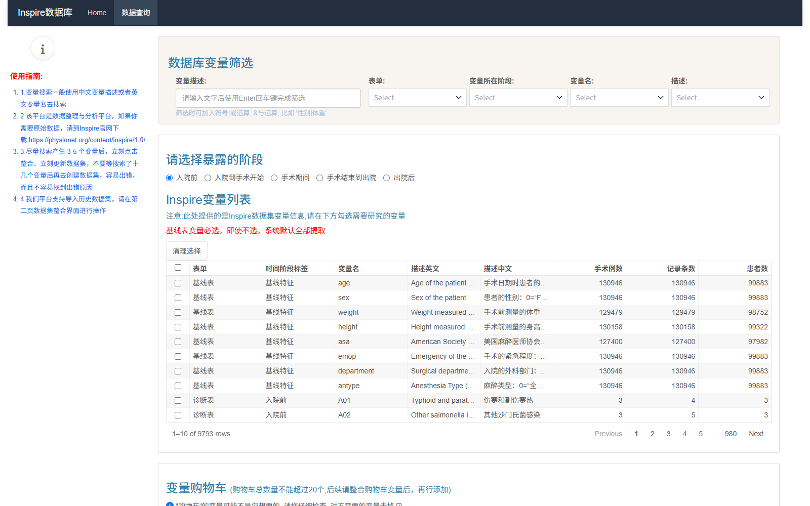

页面从左到右、从上到下依次是：

```
左侧：使用指南（4 条，红字）
右侧：
  ┌ 数据库变量筛选 ────────────────────────────┐
  │ 变量描述: [____请输入文字后使用Enter回车键完成筛选]
  │ 表单:[Select] 变量所在阶段:[Select] 变量名:[Select] 描述:[Select]
  └────────────────────────────────────────────┘
  ┌ 请选择暴露的阶段 ───────────────────────────┐
  │ ○入院前 ○入院到手术开始 ○手术期间           │
  │ ○手术结束到出院 ○出院后                     │
  └────────────────────────────────────────────┘
  ┌ INSPIRE变量列表 ─── [清理选择] ────────────┐
  │ ☐ 表单 | 时间阶段标签 | 变量名 | 描述英文 | 描述中文
  │ （980 页，每页 10 行）
  └────────────────────────────────────────────┘
  ┌ 变量购物车（不超过 20 个） ─────────────────┐
  │ [清空购物车] [下载变量信息] [选择变量信息文件]
  └────────────────────────────────────────────┘
  [变量整合和队列设计]
```

### 6.2 搜索：全平台唯一需要回车的地方

输入框的提示文字就是 *"请输入文字后使用 Enter 回车键完成筛选"*。

**语法**：支持布尔运算

| 符号 | 含义 | 例子 |
|---|---|---|
| `\|` | 或 | `性别\|体重` |
| `&` | 与 | `白蛋白&术前` |

🔬 实测的几个搜索（下图为搜"白蛋白"的结果）：

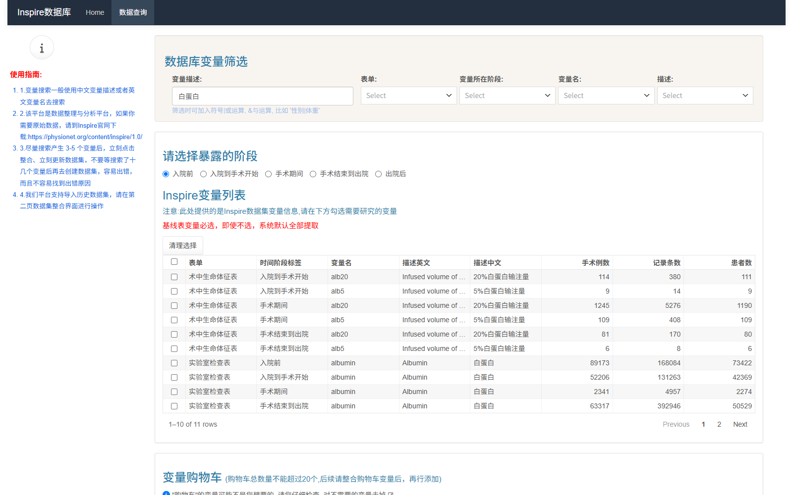

| 关键词 | 命中条数 | 命中内容 |
|---|---|---|
| `性别\|体重` | 2 | `sex`、`weight` |
| `白蛋白` | 10 | `albumin` × 4 个阶段 + `alb5`/`alb20` 输液量 × 3 个阶段 |
| `年龄` | 8 | `age`、`height`、`H25 年龄相关性白内障`、`R54 与年龄相关的身体虚弱` 等 |
| `高血压` | 37 | `I10 原发性高血压`、`I11`、`I12`、`I15`、`O10–O16` 等，每个各阶段一份 |
| `院内死亡` | 4 | `death in hospital` 在 4 个阶段各一条 |

**两个要提醒的**：

1. **搜索匹配的是中英文描述文本**，不只是变量名。所以搜"年龄"会搜出一堆"年龄相关性白内障"这类诊断码。
2. **搜索是子串匹配，不分词**。搜"术后入ICU"搜不到东西（因为描述里写的是"术后是否入 ICU"这类措辞），换成"ICU"或"重症"也可能不中——**中文描述里的用词跟你的直觉经常不一样，多换几个词试**。

**3. 🆕 中文词想不起来？直接搜英文。**

搜索框**同时匹配「描述英文」列**。中文描述里的用词常常跟直觉不一样（搜"术后入ICU"搜不到），但英文描述是标准医学术语，命中率高得多。

🔬 实测：搜 `Hemoglobin` → 正确返回 `hb` 和 `hba1c` 在全部 5 个阶段的条目：

| 表单 | 阶段 | 变量名 | 描述英文 |
|---|---|---|---|
| 实验室检查表 | 入院前 | hb | Hemoglobin |
| 实验室检查表 | 入院前 | hba1c | Hemoglobin A1c |
| 实验室检查表 | 入院到手术开始 | hb | Hemoglobin |
| …（每个变量 × 5 个阶段） | | | |

所以策略是：**先想英文术语（Hemoglobin / Creatinine / Death / ICU），搜不到再换中文词。**

🔬 **一个实测的小坑**：输入框必须真正拿到焦点、并且触发过输入事件，回车才会生效。如果你发现敲了字列表没动，换个做法——按一下 **Tab** 让输入框失焦，再按回车。

### 6.3 四个筛选器

| 筛选器 | 可选项 | 什么时候用 |
|---|---|---|
| **表单** | 病房生命体征表 / 基线表 / 实验室检查表 / 手术表 / 术中生命体征表 / 药物表 / 诊断表 | 已经知道要找的东西在哪张表 |
| **变量所在阶段** | 出院后 / 基线特征 / 入院到手术开始 / 入院前 / 手术结束到出院 / 手术期间 | **最常用的筛选器**，直接锁定阶段 |
| **变量名** | 变量名字典 | 知道英文变量名时最精确 |
| **描述** | 描述文本字典 | 按中文/英文描述查 |

都是可搜索的下拉，支持多选。右侧有"清理选择 / Reset filters"一键清空。

### 6.4 "请选择暴露的阶段"——最容易误解的地方

这 5 个单选按钮，**不是列表筛选器**。

🔬 实测：把它从"入院前"切到"手术期间"，变量列表依然是 9,793 行，一条没少。

**它是一个声明**，作用是告诉平台"我这次研究的暴露发生在哪个阶段"，从而决定第二步"暴露的处理"里你能选哪些变量。

所以：

- 研究"术前白蛋白 → 术后死亡"：暴露阶段选 **入院前** 或 **入院到手术开始**；
- 研究"术中低血压 → 术后 AKI"：暴露阶段选 **手术期间**；
- 研究"术后早期发热 → 住院时长"：暴露阶段选 **手术结束到出院**。

**先想清楚研究问题，再选这个按钮。** 选错了不用重新加载数据，改回来即可，但已经配好的规则组要重做。

### 6.5 变量列表怎么读

每行 **9 列**：

```
☐ | 表单 | 时间阶段标签 | 变量名 | 描述英文 | 描述中文 | 手术例数 | 记录条数 | 患者数
```

🔬 实测（新版本已扩充为 9 列，旧版只有前 6 列）：

```
☐ | 诊断表      | 入院前        | I10  | Essential (primary) hypertension | 原发性（本质性）高血压 | 8537 | 25101 | 6893
☐ | 实验室检查表 | 入院前        | albumin | Albumin | 白蛋白 | ... | ... | ...
☐ | 诊断表      | 手术结束到出院 | death in hospital | death in hospital | 院内死亡 | ... | ... | ...
```

**每列怎么看**：

| 列 | 用法 |
|---|---|
| 表单 | 数据来自哪张长表 |
| **时间阶段标签** | ⭐ **最重要的一列**——同一个变量会有 5 行，靠这列区分它属于哪个阶段 |
| 变量名 | 英文变量名（写代码时用这个） |
| 描述英文 / 描述中文 | 搜索时匹配的文本 |
| **手术例数** | 该阶段有该变量的手术台次 = **样本量上限**（见 [§4.4](#44-变量可得率做样本量估算之前先看这个)） |
| 记录条数 | 总记录数；明显大于手术例数说明同一台手术被记了多次 |
| 患者数 | 患者去重数；小于手术例数说明有人做了多次手术 |

**操作要点**：

- **表头可以排序**：点"时间阶段标签"能把同阶段的变量聚在一起，很好用；
- **表头复选框**可以全选当前页；
- **清理选择**清空本页勾选。

> 💡 **先看后三列再勾选。** 例：搜"白蛋白"出来 10 条，"入院前"的 albumin 手术例数 8 万多、"手术期间"的 alb5 手术例数只有几百——统计量直接告诉你哪个变量撑得起样本量。

### 6.6 变量购物车

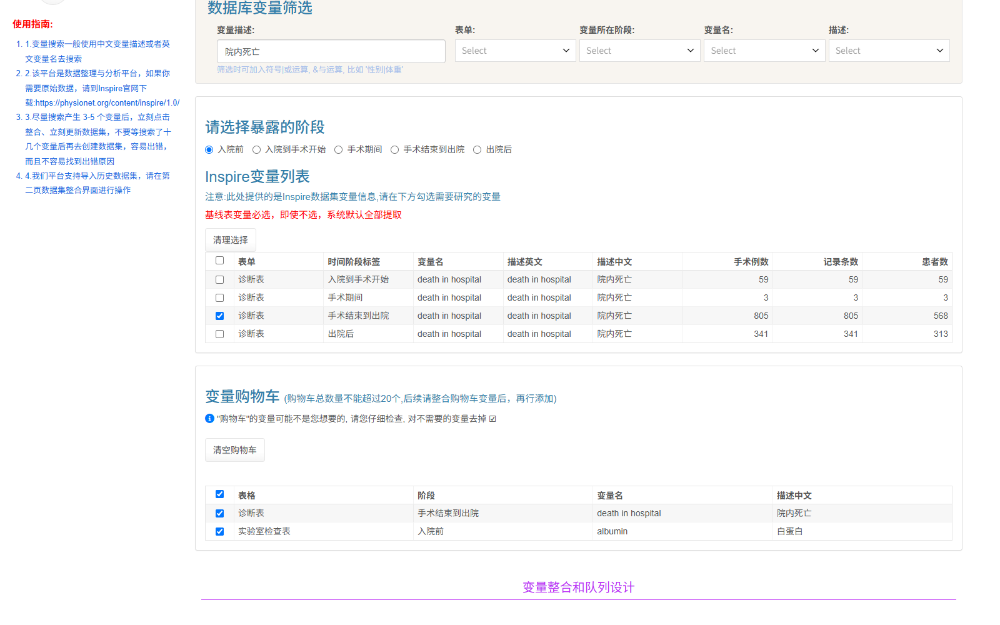

- 上限 **20 个**，超了要先把购物车里的"整合"掉（点第二步按钮），再回来加；
- 想去掉某个变量：在购物车里**取消勾选**它（界面提示："对不需要的变量去掉 ☑"）；
- **清空购物车**：一键清空；
- **下载变量信息**：把当前清单存成文件；
- **选择变量信息文件**（Browse…）：上传之前下载的清单，恢复购物车。

> 上传/下载这套机制是平台留给你的**历史记录**。做研究时建议每确定一版变量清单就下载一份，命名带上日期，论文返修时你会感谢自己。

### 6.7 本阶段操作清单

```
[ ] 用一句话写下研究问题（暴露是什么、结局是什么）
[ ] 确定暴露阶段 → 勾选对应的单选框
[ ] 搜暴露变量 → 只勾目标阶段那一行
[ ] 搜结局变量 → 勾选（结局只能用【暴露阶段及其之后】的阶段，不能更早）
[ ] 搜需要的协变量（也可以完全依赖基线表，它全给）
[ ] 逐个核对购物车里的"阶段"列，取消误勾
[ ] 变量数 ≤ 20
[ ] 点"变量整合和队列设计"
```

---

## 第七章 第二步 变量整合与队列设计

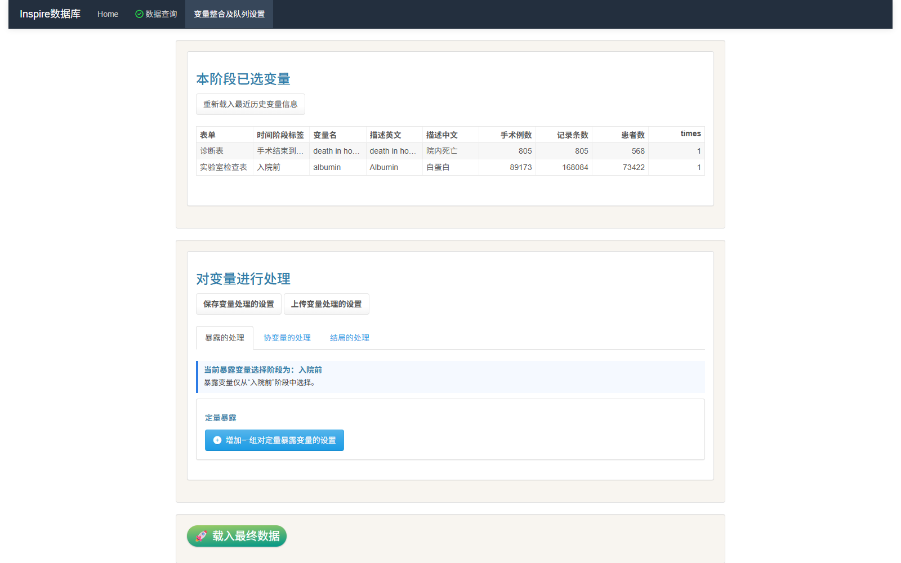

这一步是整个平台的核心。**在这里，你把一堆变量变成一个有明确时间定义的队列。**

### 7.1 界面导览

```
本阶段已选变量
  [重新载入最近历史变量信息] [下载变量信息] [选择变量信息文件 Browse...]
  ┌ 表格 ──────────────────────────────────────┐
  │ 表单 | 时间阶段标签 | 变量名 | 描述英文 | 描述中文 | times
  └────────────────────────────────────────────┘

对变量进行处理
  [保存变量处理的设置] [上传变量处理的设置] [选择变量提取设置文件 Browse...]
  [下载变量提取设置]

  ┌ 暴露的处理 │ 协变量的处理 │ 结局的处理 ┐     ← 三个选项卡
  │  各组的变量 + 时间窗 + 提取方式           │
  └──────────────────────────────────────────┘

  [🚀 载入最终数据]
  [进入数据整理]
```

### 7.2 本阶段已选变量

表格里就是你的购物车，多了个 `times` 列（通常是 1）。

三个按钮：

| 按钮 | 作用 |
|---|---|
| 重新载入最近历史变量信息 | 恢复上一次整合的变量清单（会话内有效） |
| 下载变量信息 | 把清单存成文件 |
| 选择变量信息文件 | 上传清单文件 |

### 7.3 暴露的处理

顶部有一条蓝色提示条，写着当前约束：

```
┌────────────────────────────────────────────┐
│ 当前暴露变量选择阶段为：入院前              │
│ 暴露变量仅从"入院前"阶段中选择。            │
└────────────────────────────────────────────┘
```

下面分两类：

| 类型 | 按钮 | 提取方式 |
|---|---|---|
| **分类暴露** | 增加一组对分类暴露变量的设置 | 首次 / 末次 / 任意一次 |
| **定量暴露** | 增加一组对定量暴露变量的设置 | 首次 / 末次 / 均值 / 中位数 / 最大值 / 最小值 |

点"增加一组"，会展开一个面板：

```
处理第 1 组定量暴露变量
  选择规则组 1 的变量          ← 多选下拉，只列出该阶段内可选变量
  设置规则组 1 的时间窗         是 / 否   ← 选了「是」才会出现下面两行
  规则组 1 允许变量发生在哪个阶段  ● 以 阶段终点 为锚点，向前取 t 分钟  ← 定量组只有这一个选项
  请输入时间 t，单位为分钟
  规则组 1 的提取方式           首次/末次/均值/中位数/最大值/最小值
```

#### 时间窗的锚点取决于变量类型（实测，容易踩错）

「时间窗 = 是」之后，窗口的锚点**不是你能自由选的**——它由变量类型决定。实测：

| 变量类型 | 锚点 | 实际窗口 |
|---|---|---|
| **定量**组 | 阶段终点，向前取 t | 终点前 t 分钟 到 阶段终点 |
| **分类**组 | 阶段起点，向后取 t | 阶段起点 到 起点后 t 分钟 |

🔬 实测证据：「对变量进行处理」底部的参数汇总表里，同一份配置的定量暴露与分类结局窗口写法完全不同（见下图与 §7.7）：

```
起始时间                    -> 终点时间
----------------------------|---------------------------
segment_end - 1440          -> segment_end      ← 定量组：终点前 1440 分钟
segment_start               -> segment_start + 10080  ← 分类组：起点后 10080 分钟
segment_start               -> segment_end      ← 时间窗 = 否（整段）
```

**「时间窗 = 否」是什么意思？** 就是**取整个阶段**，不做裁剪。此时参数汇总表里显示的起始/终点是阶段起止。

> ⚠️ **设 t 之前一定要看汇总表确认锚点。** 汇总表显示定量组的 t 是"从阶段终点往回数"（终点 − t），分类组是"从阶段起点往后数"（起点 + t）——同一个 10080，两边含义相反。**分类结局设 t 时务必核一遍汇总表**，确认是你要的那个窗口。

#### ⚠️ 各面板控件并不完全一致

🔬 实测：分类**暴露 / 协变量**组的面板只有「时间窗」和「提取方式」两个控件，**没有跨阶段开关**；分类**结局**组则多一个「允许变量跨阶段」。

```
处理第 1 组分类暴露变量
  选择规则组 1 的变量
  设置规则组 1 的时间窗         是 / 否
  规则组 1 的提取方式           首次 / 末次 / 任意一次
```

这是**界面上的不对称，不是 bug**。

**分类暴露/协变量既没有跨阶段开关，窗口也只能从阶段起点往后数**；只有分类结局能选跨阶段。

> **实践建议**：如果你发现分类组的选项"不够用"，先确认这确实是平台的限制，再考虑把它当定量变量（取值 0/1）处理，或者换个阶段去选变量。

**可以加多组。** 一个研究完全可能有多个暴露：

| 研究 | 暴露组 1 | 暴露组 2 |
|---|---|---|
| 术前营养与预后 | 白蛋白（入院前，t=1440，末次） | 血红蛋白（入院前，t=1440，末次） |
| 术中管理对结局的影响 | 最低 MAP（手术期间，t=手术时长，最小值） | 输液总量（手术期间，均值） |

每组独立设时间窗，互不影响。

**"减少一组"** 按钮就在旁边，看不顺眼就删掉重来。

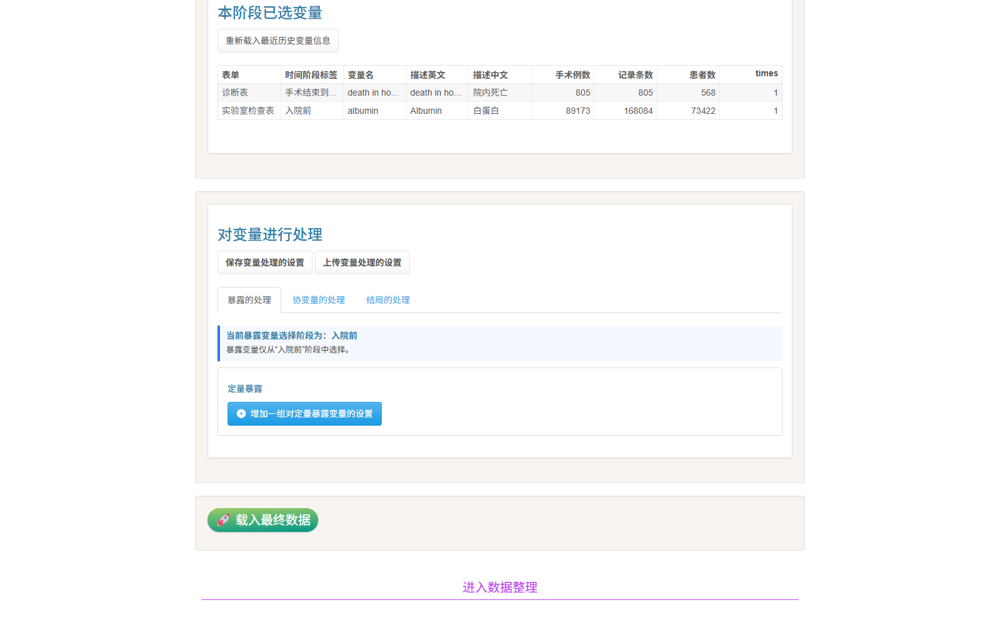

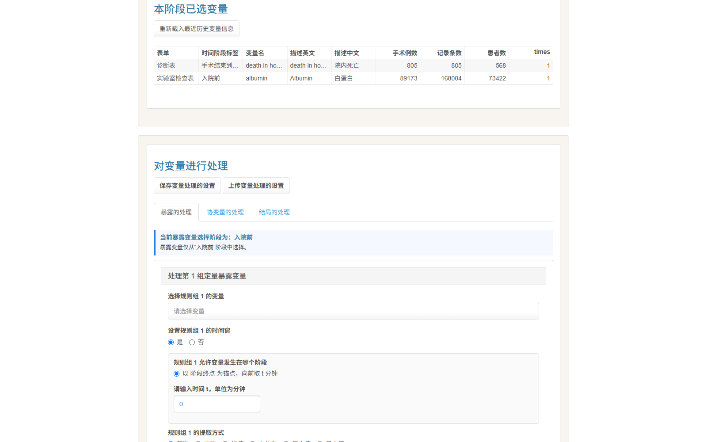

### 7.4 协变量的处理

顶部提示：

```
┌────────────────────────────────────────────┐
│ 当前协变量可选择的阶段为(暴露及之前的阶段)：入院前 │
└────────────────────────────────────────────┘
```

同样分 **分类协变量 / 定量协变量**。每个规则组比暴露多一个"允许变量跨阶段"开关。

**实操建议**：基线表已经免费给了年龄、性别、体重、身高、ASA、急诊标志、科室、麻醉类型——**这 8 个基本涵盖了一篇围手术期论文的常规调整变量**。除非你要调整的变量不在基线表里（比如术前肌酐），否则协变量这一栏可以不动。

### 7.5 结局的处理

顶部有两段提示：

```
当前结局变量可选择的阶段为：
  入院前 / 入院到手术开始 / 手术期间 / 手术结束到出院 / 出院后
此外，还可以选择当前暴露阶段"入院前"中未被暴露变量和协变量使用的变量。

选择随访起点
  ● 以暴露时间作为起始点（多暴露以末次暴露时间为起点）
  ○ 以特定时间点作为起始点（以暴露所在阶段的终点为最早可选起点）
```

规则组同样分 **分类结局**（首次/末次/任意一次）和 **定量结局**（首次/末次/均值/…）。

> ⚠️ **上面那句"可选择的阶段为：入院前 / … / 出院后"会列出全部 5 个阶段，但不代表你都能选。**
> 实际规则是 **结局阶段不得早于暴露阶段**——可选范围是「暴露阶段及其之后」。
> 若你的暴露阶段靠后（如"出院后"），前面阶段的变量在结局下拉里**根本不会出现**。原因和解法见 [§3.6](#36-暴露--协变量--结局的取数规则)。

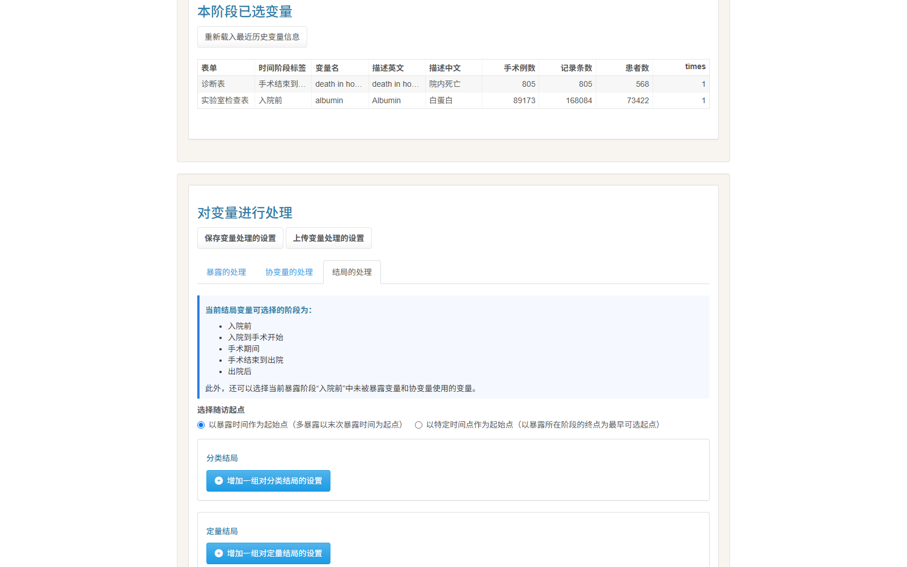

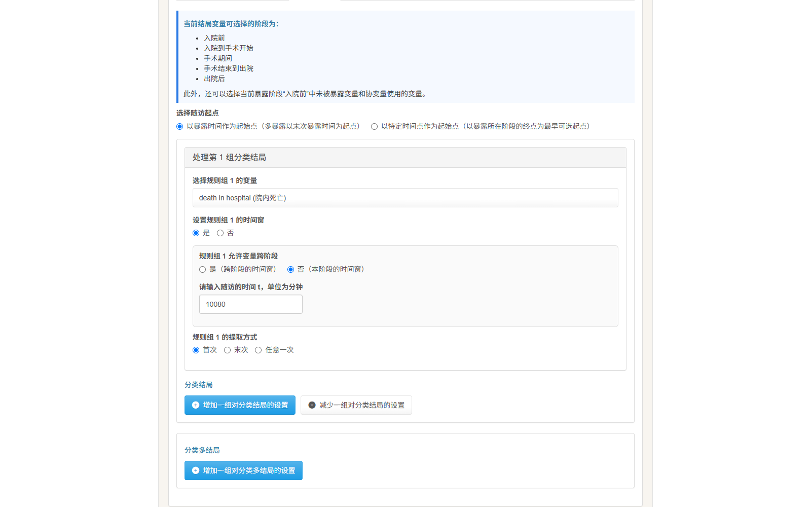

**结局面板比暴露多一个关键参数：随访时间 t。** 这个 t 决定你要随访多久：

| 结局 | 建议随访 t | 换算 |
|---|---|---|
| 院内死亡 / 住院期并发症 | 先按默认不设，或设得足够大 | — |
| 术后 30 天死亡 | 43200 | 30 天 |
| 术后 90 天死亡 | 129600 | 90 天 |
| 术后 1 年结局 | 525600 | 365 天 |

> **小技巧**：如果你只想问"住院期间有没有发生"，用基线表自带的 `is_inhosp_death` 就够了，不必自己去诊断表里捞 `death in hospital`。基线表的衍生列已经处理好时序。

### 7.6 设置文件的保存与上传

平台提供两套"下载/上传"，这是**可复现性的唯一保障**：

| 类别 | 下载 | 上传 |
|---|---|---|
| 变量清单 | 下载变量信息 | 选择变量信息文件（Browse…） |
| 提取参数 | 下载变量提取设置 / 保存变量处理的设置 | 上传变量处理的设置 / 选择变量提取设置文件 |

**论文返修、换电脑、合作者复现时，靠的就是这几个文件。请务必下载存档，文件名带上日期和版本号。**

#### ⭐「下载变量提取设置」的 JSON 才是核对参数的权威依据

这是本教程最推荐的一个习惯。

平台在**第一步**也提供了「下载变量提取设置」，它下下来是一个 **JSON 文件**，里面有一节 `final_config_snapshot`，**逐字段记录了平台实际采用的参数**：

```
时间范围标签 | 变量名  | method | 跨阶段   | 起始时间       -> 终点时间     | 变量类型
入院前      | I10    | 首次   | 不跨阶段 | segment_start  -> segment_end | 分类暴露
手术期间     | 0FB00  | 首次   | 不跨阶段 | segment_start  -> segment_end | 分类结局
```

**为什么它比界面可靠？** 因为界面显示的是**控件当前值**，而 [§7.7](#77-载入最终数据真正生成数据的一步) 里已经证明：**界面显示的值 ≠ 实际写进 Shiny 的值**（新增规则组的变量下拉会"显示但没登记"）。

**所以核对参数的顺序应该是：**

1. 🥇 **下载 JSON，读 `final_config_snapshot`**（权威）；
2. 🥈 看界面底部"对变量进行处理"的汇总表（参考，可能显示默认值）。

**顺带一个用处**：JSON 里有 `counters`，记录了你加过几组暴露/协变量/结局。载入前扫一眼，能立刻发现"我加的那组到底登记上没有"。

### 7.7 载入最终数据：真正生成数据的一步

点下去之后，平台在服务端把 6 张长表按你的规则组折叠成宽表。等几秒到几十秒，会出现提示：

> **更新完成，您可继续前往第一页挑选指标**

然后下方刷出新表格，**第一行就是最终列名**。

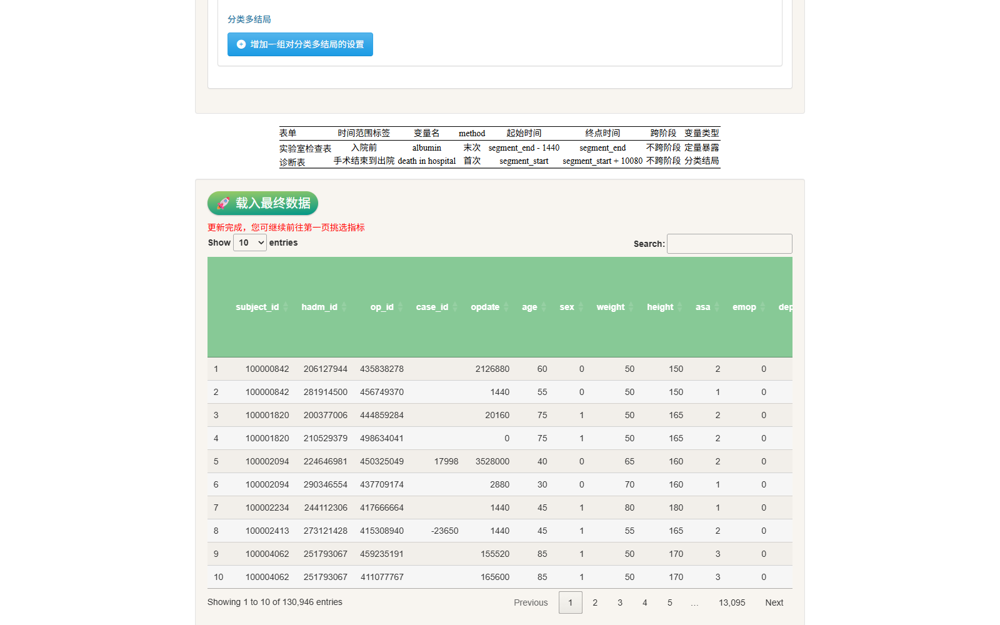

🔬 实测（暴露=白蛋白、结局=院内死亡），130,946 行 × 39 列：

```
[1–27]  基线表原始列
        subject_id  hadm_id  op_id  case_id  opdate  age  sex  weight  height  asa
        emop  department  antype  orin_time  orout_time  opstart_time  opend_time
        admission_time  discharge_time  anstart_time  anend_time  cpbon_time
        cpboff_time  icuin_time  icuout_time  inhosp_death_time  allcause_death_time

[28–33] 基线表衍生结局列
        is_inhosp_death  is_first_admission  is_first_surgery  is_first_icu
        icu_overlap_type  has_postop_icu

[34–40] 你选的变量
        实验室检查表_入院前_albumin_末次
        实验室检查表_入院前_albumin_末次_time
        cohort_start_time
        诊断表_手术结束到出院_death in hospital_首次
        诊断表_手术结束到出院_death in hospital_首次_time
        诊断表_手术结束到出院_death in hospital_首次_follow_time
```

**列名规则：**

```
表单_阶段_变量名_提取方式            ← 变量值
…_time                              ← 这个值发生在时间轴的哪一分钟
…_follow_time                       ← 只有结局有：随访时长（分钟）
cohort_start_time                   ← 随访起点
```

**两个必须知道的点：**

1. **每加一批变量，都要重新点一次"载入最终数据"。** 回到第一步加变量，再回来重新载入。不点的话新增的规则组不会进数据集。
2. **变量下拉里"显示出来的默认值"不等于"已选中的值"。** 一个新增加的规则组，下拉框里可能已经默认显示了一个变量，但如果你没手动点过它，Shiny 可能没有把这个值登记进去——结果就是"载入最终数据"之后**这一组没有产生任何列**。
   🔬 实测踩过这个坑：添加了分类暴露组但没动下拉，载入后发现没有对应列；在下拉里重新点选一次该变量再载入，列就出来了。
   **保险做法：每次新增规则组后，都在变量下拉里重新点一下目标变量。**

### 7.8 本阶段操作清单

```
[ ] 确认"当前暴露变量选择阶段"和你研究设计一致
[ ] 暴露组：选变量 → 时间窗(是/否) → 锚点 → t 分钟数 → 提取方式
[ ] ⚠️ 分类暴露的提取方式【不要选「任意一次」】→ 会导致载入失败（§3.8 反面教材 5）
[ ] 新增规则组后，都在变量下拉里重新点一下目标变量（§7.7 那个坑）
[ ] 下载「变量提取设置」JSON，打开 final_config_snapshot 逐行核对参数：
      变量名 / method / 跨阶段 / 起始时间 / 终点时间 / 变量类型
      （界面汇总表仅供参考，以 JSON 为准）
[ ] 协变量组：本阶段没有列出的阶段不能选，想调整的变量在不在可选范围里
[ ] 结局组：选变量 → 跨阶段（能不跨就不跨）→ 随访 t → 提取方式
[ ] 选择随访起点（生存分析才需要多想）
[ ] 点 🚀 载入最终数据 → 等"更新完成"
[ ] 展开数据预览，确认新列都出现了、列数对不对（33 基线 + 你选的变量）
[ ] 下载"变量信息"和"变量提取设置"两个文件存档
[ ] 点"进入数据整理"
```

> **载入失败怎么办？** 报 `An error has occurred...` 时不要盲改配置，按 [§12.3 最小配置排错法](#123-载入失败怎么排错最小配置法) 走一遍。

---

## 第八章 第三步 数据整理


这一步是可选的。**如果你的变量都是现成的，可以直接跳到第四步。**

### 8.1 界面导览

```
[打开我的数据]  [进入数据纳排]
数据初步整理
  ┌ 衍生新变量 │ 定量变量转分类 ┐
  └ 整理后数据 ─────────────────┘
     ┌ 数据集 │ 数据库变量概览 │ 数据库变量缺失预览 ┐
```

### 8.2 衍生新变量

用来把几列合成一列：

| 控件 | 说明 |
|---|---|
| 新增变量名 | 自己起名，会成为新的一列 |
| 计算方法的选择 | ○ 简单求和　○ 自定义 |
| 请选择连续型变量 | 参与计算的一列或多列 |
| 将涉及计算的变量缺失转为 0（不改变原数据） | **建议勾上** |
| 确认 | 生成 |

"将涉及计算的变量缺失转为 0"这一项要重点说：不勾的话，**只要参与计算的任何一列缺失，结果就是缺失**。比如你算"合并症个数 = 高血压 + 糖尿病 + 冠心病"，患者只要缺一个诊断记录，合并症个数就变成 NA。

常见用途：
- 合并症计数（Charlson / Elixhauser 简版）；
- 术中总输液量 = 晶体 + 胶体 + 血制品；
- 累计血管活性药剂量。

### 8.3 定量变量转分类

| 控件 | 说明 |
|---|---|
| 请选择连续型变量 | 要分组的列，比如白蛋白 |
| 请选择分组方式 | 自定义分组 / **按照中位数分组** / 三分位数 / 四分位数 / 五分位数 / **转换为标准化 z 值** |
| 请输入分组界值 | 只有"自定义分组"才需要，英文逗号分隔，如 `30,35` |
| 开始分组 | 生成分组列 |

**最常用的两个**：

- **按照中位数分组**：一键做出高/低两组，围手术期研究里最常见；
- **转换为标准化 z 值**：做连续变量分析时方便解释（每升高 1 个 SD 的 OR）。

> 注意：中位数分组是**数据驱动**的，不是临床界值。审稿人有时会要求你用临床界值（比如白蛋白 < 3.5 g/dL），这时用"自定义分组"。

### 8.4 整理后数据的三个页签

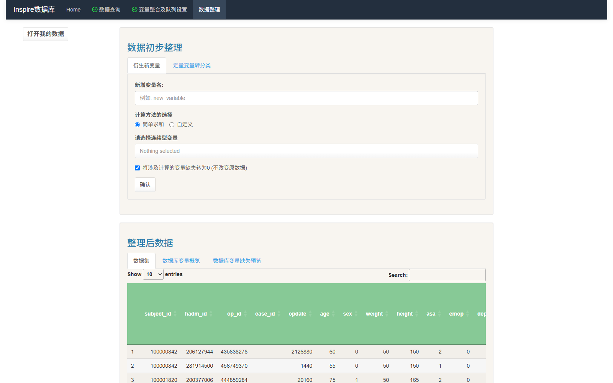

| 页签 | 能看到什么 |
|---|---|
| **数据集** | 完整宽表预览，可搜索、可翻页 |
| **数据库变量概览** | R 的 `str()` 输出，逐列显示类型和前几个取值 |
| **数据库变量缺失预览** | 各列的缺失情况 |

🔬 "数据库变量概览"实测输出：

```
Classes 'data.table' and 'data.frame': 130946 obs. of 39 variables
 $ subject_id : int  100000842 100000842 100001820 ...
 $ hadm_id    : int  206127944 281914500 200377006 ...
 $ op_id      : int  435838278 456749370 444859284 ...
 ...
```

**养成习惯：载入数据后先看"缺失预览"，再决定要不要调整时间窗。** 如果你设的 t 太小，某个变量会整列缺失——这一步能立刻发现。

### 8.5 本阶段操作清单

```
[ ] 看一遍"数据库变量缺失预览"，暴露/结局/协变量的缺失率能不能接受
[ ] 需要的话，回第二步调大 t 或换提取方式，重新载入
[ ] 需要的话，在这里衍生合并症计数等新变量
[ ] 需要的话，把连续暴露按中位数或临床界值转成分类
[ ] 进入数据纳排
```

---

## 第九章 第四步 纳排与流程图

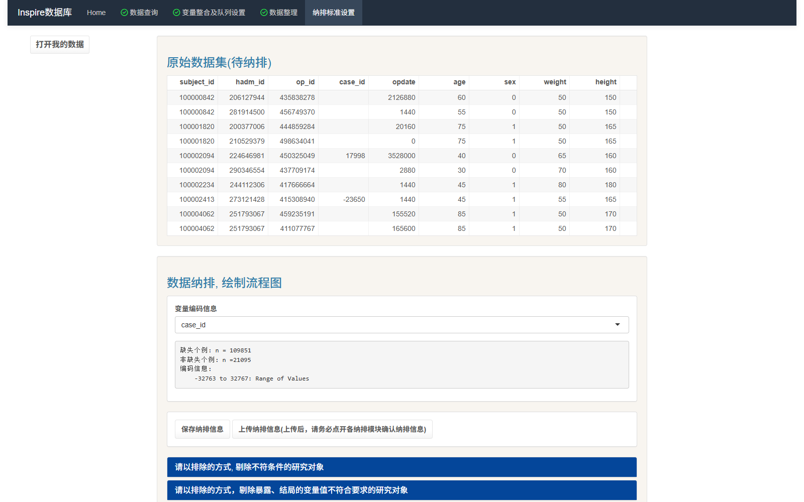

### 9.1 界面导览

点"进入数据纳排"后：

```
[打开我的数据]
原始数据集(待纳排)                      ← 宽表预览

数据纳排, 绘制流程图
  变量编码信息
    [变量编码信息 ▾] [编码值 ▾]
    case_id
    缺失个例: n = 109851
    非缺失个例: n = 21095
    编码信息:
        -32763 to 32767: Range of Values
  [保存纳排信息] [上传纳排信息]

  ┌ 请以排除的方式, 剔除不符条件的研究对象 ────────┐
  │  [添加纳排条件] [清除所有条件]  ☑是否自动剔除缺失 │
  └──────────────────────────────────────────────┘
  ┌ 请以排除的方式，剔除暴露、结局的变量值不符合要求的研究对象 ┐
  └──────────────────────────────────────────────┘
  ┌ 请以排除的方式，剔除其他变量的变量值不符合要求的研究对象 ┐
  └──────────────────────────────────────────────┘

纳排流程图    [创建/更新流程图]
纳排后数据集  [创建/更新流程图] [Excel] [SPSS] [下载纳排后数据集]
             提示：请创建/更新流程图后再下载数据
```

### 9.2 三个模块分别管什么

| 模块 | 管什么 | 举例 |
|---|---|---|
| **模块 1** 剔除不符条件的研究对象 | 人群基本特征 | 排除年龄 < 18 或 > 90；排除非全身麻醉；排除急诊手术；只保留特定科室 |
| **模块 2** 剔除暴露、结局变量值不符合要求 | 暴露缺失/异常、结局缺失/异常 | 排除暴露为 NA；排除结局为 NA；排除暴露超出合理范围 |
| **模块 3** 剔除其他变量/协变量的变量值不符合要求 | 协变量缺失/异常 | 排除 BMI 缺失；排除 ASA 缺失 |

三个模块界面完全一样，只是作用对象不同。

### 9.3 变量编码信息：写条件之前先看这个

这是很多人会跳过的面板，但它非常有用。

🔬 实测选 `case_id`：

```
缺失个例: n = 109851
非缺失个例: n = 21095
编码信息:
    -32763 to 32767: Range of Values
```

它告诉你两件事：

1. **这个变量缺多少人**；
2. **取值长什么样**——分类变量会列出每个取值和频数，连续变量给出范围。

**写排除条件之前，一定要先看一眼变量长什么样。** 比如你要排除 ASA 缺失，得先知道 ASA 的缺失标记到底是 `NA` 还是 `-1`。

### 9.4 排除条件怎么写

点"添加纳排条件"，会新增一行：

```
+排除条件 | [EXCLUDE ▾] | 变量 [case_id ▾] | 运算 [= ▾] | 变量值 [______] | [删除条件]
```

- 逻辑默认就是 **EXCLUDE**（排除掉满足条件的个体）；
- 变量下拉是可搜索的，输入关键词选；
- 运算和取值的组合见下表。

平台给的语法示例是：

> 示例1：缺失值排除请使用 `=` 搭配 `NA`；
> 示例2：范围值排除，比如排除 18-30 的值请使用 `区间(n1-n2)` 搭配 `18-30`；

常用组合表：

| 你想要的效果 | 运算 | 变量值 |
|---|---|---|
| 排除该变量缺失的人 | `=` | `NA` |
| 排除某个取值 | `=` | 取值，如 `1` |
| 排除某个区间内的人 | `区间(n1-n2)` | `18-30` |
| 排除大于某值的人 | `>` | 数值 |
| 排除小于某值的人 | `<` | 数值 |

**多个条件之间是什么关系？** 三个模块之间是**依次排除**（取交集）；同一模块内多行条件也是依次排除。所以整个纳排就是一路"减人"。

### 9.5 "是否自动剔除缺失"这个开关

默认**勾选**。

它的意思是：**只要你加了任何条件，就顺带把参与该条件的变量缺失的个体一起剔掉。**

什么时候该关掉它？
- 你打算做多重插补（MI）来处理缺失；
- 你想把缺失单独作为一个类别分析；
- 某变量缺失率很高，自动剔除会把样本砍掉一大半。

**建议**：先用默认设置跑一遍，**看流程图上的最终人数**；如果掉得太狠，回来把开关关掉再跑一遍，对比两个人数再做决定。

### 9.6 流程图

在"纳排流程图"面板里点 **创建/更新流程图**，平台会用 `viz.js` 画出入组流程图：

```
初始人群 130,946
   ↓ 排除 年龄缺失/超范围
剩余 xxx
   ↓ 排除 暴露缺失
剩余 xxx
   ↓ 排除 协变量缺失
最终分析人群 xxx
```

**这张图可以直接当论文的 Figure 1。** 而且平台会强制你先画图：

> 提示：请创建/更新流程图后再下载数据

**没画图不给下载。** 这个设计看着烦，其实是在逼你把纳排逻辑理清楚。

### 9.7 保存 / 上传纳排信息

- **保存纳排信息**：把三个模块的条件和流程图配置存成文件；
- **上传纳排信息**：上传恢复。

平台的提示：

> 上传后，请务必点开各纳排模块确认纳排信息

上传完**一定要展开三个模块逐个检查**——条件行是异步渲染的，不展开你看不到实际加载了什么。

### 9.8 下载

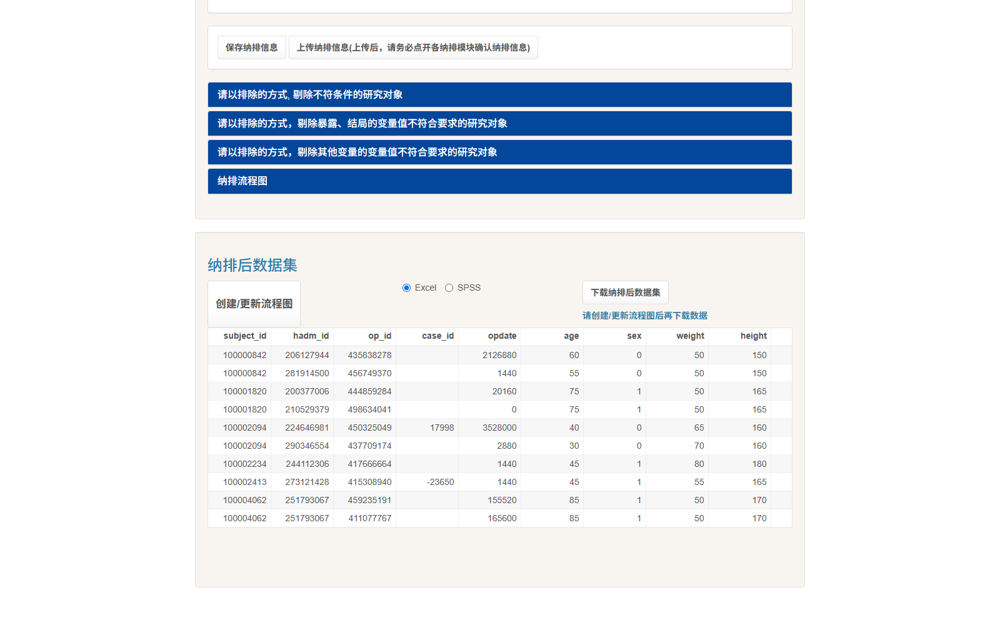

| 按钮 | 产物 |
|---|---|
| Excel | `.xlsx` |
| SPSS | SPSS 格式 |
| 下载纳排后数据集 | 打包下载 |
| 下载数据 / 下载纳排信息 | 数据与纳排配置分别下载 |

🔬 实测：点"下载纳排后数据集"后弹出遮罩 **"正在打包数据，请耐心等待！"** —— 13 万行 × 数十列，等一会儿是正常的。

### 9.9 下载之后：加密件与解密站（这一步千万别跳过）

**你下载到的 xlsx 不是能直接用的数据，而是一个【加密件】。** 这是整个流程里最容易卡住人的一环——不写清楚，很多人拿到文件会以为数据坏了。

#### 完整链路

```
① 第四步点「下载」           → 得到一个 .zip
② 解压                       → 里面是 INSPIRE_提取数据.xlsx
                                ⚠️ 但这是加密件，打不开或打开是乱码
③ 上传到【独立的解密站】      → https://zs.medsta.cn/inspire_data_encry2026/
     · 点「导入数据」
     · Enter data 页签上传该 xlsx → 点「Import data」
     · 左侧「数据导入」→ 点「参数解密」
④ 回到解密站左侧「数据下载」  → 选 CSV → 下载 → 解压
⑤ 得到 Zstats_data.csv       → ✅ 这才是能进 R / SPSS 的明文数据
```

**解密站地址和生产平台不是同一个站**（生产平台是 `zs.medsta.cn/Inspire_encryption/...`，解密站是 `zs.medsta.cn/inspire_data_encry2026/`），别找错地方。

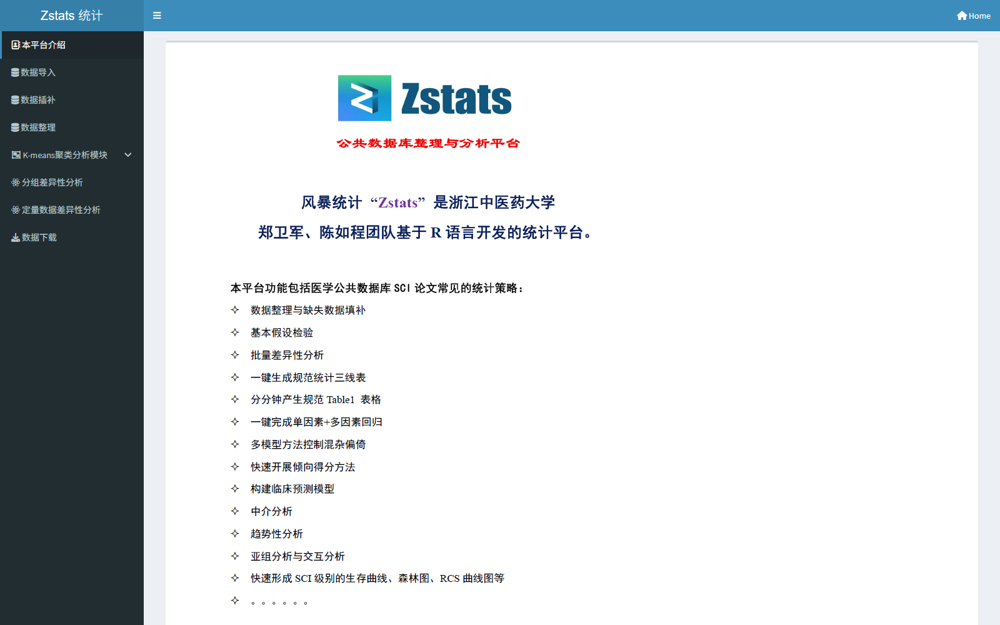

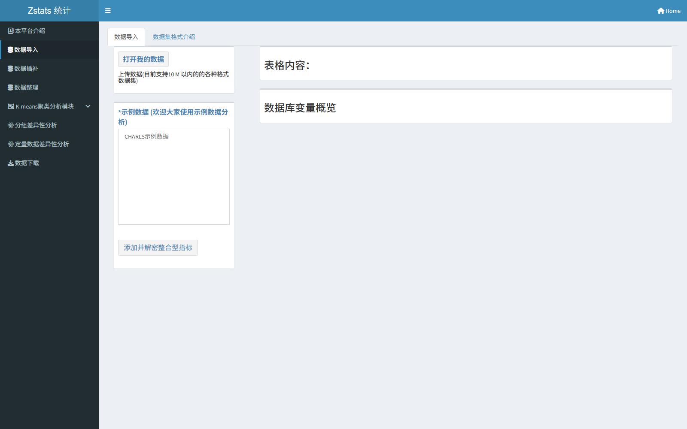

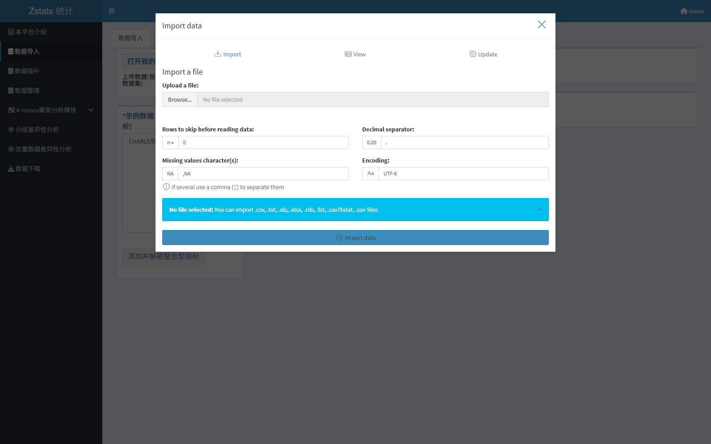

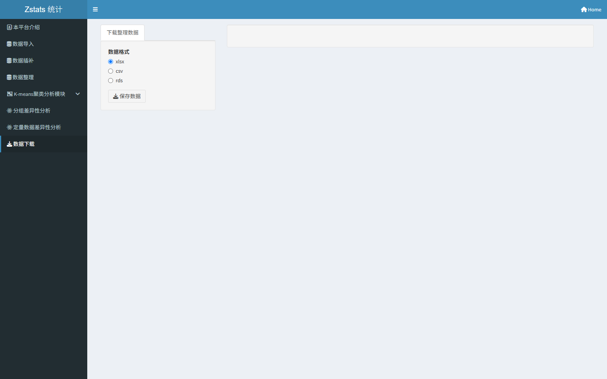

#### 加密件的三个特征（用来判断自己拿的是不是加密件）

| 特征 | 实测表现 |
|---|---|
| **列名带随机后缀** | 例：`实验室检查表_入院前_albumin_末次__2__69__1`（正常列名应该是 `..._末次`） |
| **文件大小每次都不一样** | 同一份配置导出三次，xlsx 分别是 47,297,512 / 46,253,951 / 47,513,290 字节 |
| **二进制内容不同** | 密文本身就是随机的 |

> 💡 **一句话判断**：**列名里带 `__数字__数字__数字` 这种后缀，就说明你拿的还是加密件。**

#### ⚠️ 两条必须记住的结论

**① 加密件"看起来随机"，但解密后的数据 100% 确定。**

🔬 实测：同一配置导出 **3 次**（同一会话内导出 2 次 + 全新浏览器会话从零重建配置导出 1 次），解密后的 CSV **SHA256 完全相同**（`edc262ac…c905f1e`，20,376,097 字节）。

**⇒ 不用担心"平台每次给的数据不一样"。** 加密层是随机的，数据层是确定的。

**② 想校验数据，只能校验解密后的 CSV。**

**不要**拿加密件的大小、列名、MD5 做任何比对——它们每次都变。

❌ 错误做法：`对比两次导出的加密 xlsx 大小 → 不一样 → 以为数据变了`

✅ 正确做法：`解密两次 → 对比两个 CSV 的 SHA256 → 一致 → 数据确实没变`

```bash
# 解密后校验
sha256sum A1_dec/Zstats_data.csv A2_dec/Zstats_data.csv
```

#### ⚠️ 解密站有约 50 MB 上传上限

🔬 实测：

| 文件大小 | 结果 |
|---|---|
| 48.7 MB | ✅ 通过 |
| 48.9 MB | ✅ 通过 |
| 50.9 MB | ❌ 报 `413 Entity Too Large` |
| 51.1 MB | ❌ 报 `413 Entity Too Large` |

**大致规律：48 MB 左右安全，50 MB 以上会被拒。**

**超限了怎么办？**（按推荐顺序）

1. **减列**：把当前这轮不需要的变量组删掉，重新导出（最省事）；
2. **拆分配置**：变量多的时候分两次导出，各自解密，再在 R 里 `merge`；
3. **按列剥离（进阶）**：直接改 xlsx 内部的 `xl/worksheets/sheet1.xml`，把整列去掉后重新打包。实测 51.1 MB → 48.9 MB → 44.5 MB 可行，但需要写脚本。

> **提醒**：文件大小主要由**行数（固定 130,946）× 列数**决定。列数 ≈ 33 个基线列 + 每个自选变量 1~3 列。所以**一次别贪多**——这也是为什么[§5.6](#56-容量限制速查)建议"每次搜 3–5 个变量就先整合一次"。

### 9.10 本阶段操作清单

```
[ ] 用"变量编码信息"确认关键变量的缺失数和取值分布
[ ] 模块 1：人群层面排除（年龄、麻醉类型、急诊、科室…）
[ ] 模块 2：暴露与结局的缺失/异常值处理
[ ] 模块 3：协变量缺失处理（不建议条件太苛刻）
[ ] 决定"是否自动剔除缺失"要不要勾
[ ] 创建/更新流程图 → 核对最终人数
[ ] 保存纳排信息文件存档
[ ] 下载 Excel（分析用）和 SPSS（备用）
[ ] 🔐 解压 → 上传到解密站 → 参数解密 → 下载 CSV（§9.9）
[ ] 下载的列数别超 50 MB 上限，超了先减列
[ ] 论文方法学里逐条写下纳排标准
```

---

## 第十章 打开我的数据：把外部数据导进来

第二步、第三步、第四步都有一个 **打开我的数据** 按钮。点开是一个标准的"Import data"弹窗：

| 页签 | 内容 |
|---|---|
| **Import** | 上传文件并设置读取参数 |
| View | 预览已导入数据 |
| Update | 更新数据 |

支持的文件格式：`.csv` / `.txt` / `.xls` / `.xlsx` / `.rds` / `.fst` / `.sas7bdat` / `.sav`

读取参数：

| 参数 | 说明 |
|---|---|
| Rows to skip before reading data | 跳过表头前的说明行 |
| Missing values character(s) | 缺失值标记，默认 `NA`，多个用逗号隔开 |
| Decimal separator | 小数点符号 |
| Encoding | 文件编码 |

### 10.1 什么场景用得上

1. **导入历史提取结果**：上次提了一批变量，这次想加两个，不必从头再搜一遍，把导出的 CSV 传进去继续做纳排；
2. **导入自己整理的数据**：在 R 里做完清洗，传进平台用它的纳排和流程图功能；
3. **导入别人给的数据**：格式兼容 `.sav`（SPSS），可以直接往下走。

平台自己的说明第 4 条就是讲这个：

> 我们平台支持导入历史数据集，请在第二页数据集整合界面进行操作

### 10.2 两个注意点

- **中文 CSV 一定要选对编码**（UTF-8 或 GBK），否则中文列名会变乱码，后面纳排选变量就全靠猜了；
- 导入的是**你的数据**，平台不会做时间窗处理——时间窗只在第二步对 INSPIRE 原始数据生效。

---

# 第三部分 实战与排错

## 第十一章 完整实战：从零到一份可发表的数据

### 11.1 研究问题

> 术前血清白蛋白水平与术后院内死亡的关系（全人群）。

### 11.2 变量设计

| 角色 | 变量 | 表单 | 阶段 | 时间窗 | 提取方式 |
|---|---|---|---|---|---|
| 暴露 | albumin | 实验室检查表 | 入院前 | t = 1440（24 h） | 末次 |
| 结局 | death in hospital | 诊断表 | 手术结束到出院 | 随访 t = 10080（7 d） | 首次 |
| 协变量 | age / sex / asa / emop / department / antype | 基线表 | 基线特征 | — | 自动带入 |

### 11.3 逐步操作

```
① 登录门户 www.zstats.cn（微信扫码）
   → 顶部 ZstatsAdv ▾ → INSPIRE围手术期数据库 → 数据提取 1

② 第一步：什么都不改，"请选择暴露的阶段"保持默认的"入院前"
   变量描述框输入"白蛋白" → 回车
   → 勾选 实验室检查表 | 入院前 | albumin
   变量描述框输入"院内死亡" → 回车
   → 勾选 诊断表 | 手术结束到出院 | death in hospital
   检查购物车（应该是 2 行）→ 点"变量整合和队列设计"

③ 第二步 · 暴露的处理
   点"增加一组对定量暴露变量的设置"
   → 变量 = albumin (白蛋白)
   → 时间窗 = 是
   → t = 1440
   → 提取方式 = 末次

④ 第二步 · 结局的处理
   点"增加一组对分类结局的设置"
   → 变量 = death in hospital (院内死亡)
   → 时间窗 = 是
   → 允许变量跨阶段 = 否（本阶段的时间窗）
   → 随访时间 t = 10080
   → 提取方式 = 首次
   选择随访起点 = 以暴露时间作为起始点（默认）

⑤ 下载「变量提取设置」JSON，核对 final_config_snapshot（比界面汇总表可靠）：
     albumin        | 末次 | segment_end - 1440  | segment_end | 不跨阶段 | 定量暴露
     death in hosp. | 首次 | segment_end - 10080 | segment_end | 不跨阶段 | 分类结局
   （界面底部"对变量进行处理"的汇总表也可以看，但它显示的是控件值，可能不准）

⑥ 点 🚀 载入最终数据 → 等"更新完成，您可继续前往第一页挑选指标"
   展开预览，确认多了 6 列：
     实验室检查表_入院前_albumin_末次
     实验室检查表_入院前_albumin_末次_time
     cohort_start_time
     诊断表_手术结束到出院_death in hospital_首次
     诊断表_手术结束到出院_death in hospital_首次_time
     诊断表_手术结束到出院_death in hospital_首次_follow_time

⑦ 下载"变量信息"和"变量提取设置"两个文件存档

⑧ 点"进入数据整理"
   看"数据库变量缺失预览" → 白蛋白缺失率多少？
   （如果太高，回第二步把 t 调大，比如 2880，再重新载入）

⑨ 点"进入数据纳排"
   模块 1：排除 age = NA；age < 18；age > 90
   模块 2：排除 白蛋白 = NA；排除 院内死亡 = NA
   点"创建/更新流程图" → 记下最终人数
   保存纳排信息

⑩ 点 Excel（或 SPSS）下载 —— ⚠️ 下下来的只是【加密件】！

⑪ 🔐 解密（平台外，必做，见 §9.9）：
   解压下载的 zip → 得到 INSPIRE_提取数据.xlsx（列名带 __数字__数字__数字 后缀）
   打开 https://zs.medsta.cn/inspire_data_encry2026/
   → 点「导入数据」→ Enter data 页签上传该 xlsx → 点「Import data」
   → 左侧「数据导入」→ 点「参数解密」
   → 左侧「数据下载」→ 选 CSV → 下载 → 解压
   → 得到 Zstats_data.csv   ← ✅ 这才是能进 R / SPSS 的分析数据
   （若上传报 413，说明超了 50 MB 上限，回⑩前先减掉几列再导出）
```

### 11.4 实测结果

**数据集**：130,946 行 × 39 列。

**列结构**（33 列基线 + 6 列自选）：

```
[1–27]  subject_id … allcause_death_time
[28–33] is_inhosp_death, is_first_admission, is_first_surgery,
        is_first_icu, icu_overlap_type, has_postop_icu
[34]    实验室检查表_入院前_albumin_末次
[35]    实验室检查表_入院前_albumin_末次_time
[36]    cohort_start_time
[37]    诊断表_手术结束到出院_death in hospital_首次
[38]    诊断表_手术结束到出院_death in hospital_首次_time
[39]    诊断表_手术结束到出院_death in hospital_首次_follow_time
```

**数据样例**（前 3 台手术）：

| op_id | age | sex | asa | 白蛋白_末次 | 白蛋白_time | cohort_start_time | 院内死亡 | follow_time |
|---|---|---|---|---|---|---|---|---|
| 435838278 | 60 | 0 | 2 | （缺失） | （缺失） | （缺失） | 0 | 0 |
| 456749370 | 55 | 0 | 1 | **4.4** | **−225** | **−225** | 0 | 0 |
| 444859284 | 75 | 1 | 2 | （缺失） | （缺失） | （缺失） | 0 | 0 |

**怎么读这三行：**

- 第 2 台手术白蛋白 4.4，发生在 −225 分钟（入院前 225 分钟），`cohort_start_time` 也是 −225，`_follow_time = 0` 说明没观察到死亡事件；
- 第 1、3 台手术白蛋白整行缺失——**这说明"术前白蛋白"不是每台手术都有**，做样本量估算时必须考虑进去。

### 11.5 论文方法学段落模板

> 本研究数据来源于 INSPIRE 围手术期公开数据库（韩国首尔国立大学医院，2011 年 1 月至 2020 年 12 月）。数据通过 ZSTATS 平台的 INSPIRE 数据提取系统（inspire_data_1.0.2）提取。暴露定义为**入院前 24 小时内最后一次血清白蛋白**（提取参数：阶段 = 入院前；时间窗 = 阶段终点前 1440 分钟；提取方式 = 末次）。主要结局为**术后院内死亡**（提取参数：阶段 = 手术结束到出院；时间窗 = 阶段终点前 10080 分钟；提取方式 = 首次）。随访起点为暴露测量时间。共纳入 130,946 台手术。

> 💡 **写方法学时记得加上删失规则**（[§3.7](#37-随访起点与随访终点生存分析的两端)），这是审稿人常问的点：
>
> *未发生结局的病例，随访至出院（`discharge_time`）删失；若结局为非手术类事件，则随访至该阶段截止时刻删失。*
>
> 另外，方法学里写平台版本号时**写你实际用的版本**（当前为 1.0.3），不要照抄示例里的旧版本号。

**这段话之所以能写出来，是因为你保存了"变量提取设置"文件。** 没有那个文件，几个月后你自己都说不清当时 t 填的是多少。

### 11.6 离线分析（R）

```r
library(data.table)
library(survival)

d <- fread("inspire_export.csv", encoding = "UTF-8")

# ---- 1. 中文列名太长，改短 ----
setnames(d,
  c("实验室检查表_入院前_albumin_末次",
    "实验室检查表_入院前_albumin_末次_time",
    "诊断表_手术结束到出院_death in hospital_首次",
    "诊断表_手术结束到出院_death in hospital_首次_follow_time"),
  c("albumin", "albumin_time", "inhosp_death", "follow_time")
)

# ---- 2. 暴露分组 ----
d[, alb_grp := ifelse(albumin > median(albumin, na.rm = TRUE), "High", "Low")]
d[, alb_grp := factor(alb_grp, levels = c("Low", "High"))]

# ---- 3. 逻辑回归 ----
fit <- glm(inhosp_death ~ alb_grp + age + sex + asa + emop,
           data = d, family = binomial)
summary(fit)
exp(cbind(OR = coef(fit), confint(fit)))

# ---- 4. 生存分析（平台给的随访时间是分钟，转成天）----
d[, follow_days := follow_time / 1440]
km <- survfit(Surv(follow_days, inhosp_death) ~ alb_grp, data = d)
plot(km, col = c("steelblue", "firebrick"), xlab = "Days", ylab = "Survival")

cox <- coxph(Surv(follow_days, inhosp_death) ~ alb_grp + age + sex + asa + emop,
             data = d)
summary(cox)

# ---- 5. 检查一下时间轴对不对 ----
d[!is.na(albumin_time), summary(albumin_time)]   # 应全为负数（入院前）
```

最后那行是**必做自检**：如果"入院前"的暴露时间出现了正数，说明你的时间窗或阶段选错了。

---

## 第十二章 排错手册

### 12.1 症状 → 原因 → 解决

| 症状 | 原因 | 解决 |
|---|---|---|
| 打开平台就弹"需要登录" | 跨域工具站的 token 只能由门户签发，直接访问拿不到票据 | 从 `www.zstats.cn` 门户进 INSPIRE 工具 |
| 点"去登录"跳转后又回到未登录 | 票据 60 秒过期 | 从门户重新点一次"数据提取 1" |
| 搜索框敲了字，列表没变 | 回车没有真正触发隐藏的 Trigger 按钮 | 按一下 **Tab** 让输入框失焦，再按回车 |
| 搜索结果只有一行空白 | 关键词在字典里确实没匹配 | 换关键词；或改用英文变量名；或用"表单/阶段"筛选器定位 |
| 搜"术后入ICU"没有结果 | 中文描述里的措辞跟直觉不同（如"术后是否入 ICU"） | 多换几个词试；或直接搜英文 `icu` |
| 点了"添加纳排条件"没反应 | 折叠面板里的输出被 Shiny 延迟渲染 | **先展开对应面板**，再点按钮 |
| 变量下拉只有一项 | 下拉是服务端搜索型，选项按输入动态加载 | 在框里输入关键词再选 |
| 载入最终数据后，某一组没有产生列 | 新增规则组的变量是"默认显示值"，没真正写入 Shiny 输入 | 在变量下拉里**重新点选一次**该变量，再载入 |
| 载入最终数据后，新加的变量没出现 | 加变量后没重新载入 | 回第一步加完变量，回第二步**再点一次** 🚀 载入最终数据 |
| 某个变量整列都是 NA | t 太小，时间窗内没有记录；或该变量本身缺失率高 | 调大 t；或先看"数据库变量缺失预览"评估缺失率 |
| 界面报"请设置一个大于 0 的时间" | 开了时间窗但 t 留空或填 0 | 填入具体分钟数 |
| 纳排后人数没变 | 条件没生效，或"是否自动剔除缺失"干扰了预期 | 展开模块确认条件行还在；重新上传纳排信息后再逐个模块展开确认 |
| 点下载按钮没反应 | 数据在服务端打包，需要等待 | 看到"正在打包数据，请耐心等待！"是正常的 |
| 页面刷新后勾选全没了 | Shiny 会话重建，购物车是会话级的 | 重要节点先"下载变量信息"存档，刷新后上传恢复 |
| 中文列名导入 R 变乱码 | 导出 CSV 编码问题 | `fread(..., encoding = "UTF-8")`，或改存 xlsx |
| 术中指标出现了术前的时间值 | 阶段选错（选了"入院到手术开始"却想取术中值） | 回第一步核对购物车里的"时间阶段标签"列 |
| **「载入最终数据」报 `An error has occurred...`** | 🆕 最常见原因：**分类暴露的提取方式选了「任意一次」** | 改用「首次/末次」；先刷新页面；参考 [§12.3 最小配置排错法](#123-载入失败怎么排错最小配置法) |
| **下载的 xlsx 列名带 `__2__69__1` 后缀 / 打不开** | 🆕 拿到的是**加密件**，还没解密 | 上传到解密站 `zs.medsta.cn/inspire_data_encry2026/` 解密，见 [§9.9](#99-下载之后加密件与解密站这一步千万别跳过) |
| **解密站上传报 `413 Entity Too Large`** | 🆕 文件超过约 50 MB 上限 | 减列重新导出，或分两次导出；见 [§9.9](#99-下载之后加密件与解密站这一步千万别跳过) |
| **教程里的平台地址打不开（404）** | 🆕 平台更新了版本号，旧实例被下线 | 从门户 `www.zstats.cn` 进，或查目录页 `39.170.49.93:3838/Inspire_encryption/Inspire_data/`，见 [§5.0](#50-版本适配说明先读这一节) |
| **某分类变量的缺失率是 0%** | 🆕 新版分类变量为**全量 0/1、没有 NA**，"未发生"和"无记录"都记成 0 | 需要区分缺失时自己回填 `NA`，见 [§12.2](#122-下载后的数据质量自检清单) |
| **结局的变量下拉是空的 / 找不到想要的阶段** | 🆕 **结局阶段不得早于暴露阶段**——你若把暴露阶段设成了靠后的阶段（如"出院后"），前面阶段的变量就不会出现在结局下拉里 | 把暴露阶段往前挪，或改用基线表现成的结局列，见 [§3.6](#36-暴露--协变量--结局的取数规则) |

### 12.2 下载后的数据质量自检清单

拿到数据后，花 10 分钟做这几件事，能省掉后面几天的返工：

```
[ ] 行数对不对？平台是 130,946 行（没做纳排的话）
[ ] 列数 = 33 + 你选的变量数 × 1~3（有的变量带 _time、_follow_time）
[ ] 每个自选变量的缺失率是多少？超过 30% 要重新考虑时间窗
[ ] 时间轴方向对不对？
      "入院前"的 *_time 应该全为负数
      "手术期间"的 *_time 应该在 0 到手术时长之间
[ ] ⭐ 交叉校验：挑一个分类变量，它的"判 1 台数" == 首页的「手术例数」吗？
      不等 => 阶段或时间窗设错了，回第二步核对（详见下方）
[ ] 结局的删失时间对不对？
      手术类结局的 0 值台，_time 应该 == discharge_time
      其它事件的 0 值台，_time 应该 == 该阶段截止时间
[ ] cohort_start_time 是不是等于暴露变量的 _time？（选了"以暴露时间为起点"的话）
[ ] follow_time 有没有负数？（有的话说明结局时间早于随访起点，逻辑有问题）
[ ] 分类变量的取值是不是只有 0/1？（新版没有 NA 了，别混进 -1、99 之类的编码）
[ ] is_inhosp_death 的阳性数和"院内死亡"结局的阳性数差多少？
      差太多说明两个口径不一样，选一个用
[ ] 基线表 8 个变量的分布合理吗？（年龄中位数、性别比例、急诊比例）
```

#### ⭐ 交叉校验法：用首页统计验证你的配置（强烈推荐）

**规则：分类变量的「判 1 台数」应当等于首页同一变量、同一阶段的「手术例数」。**

🔬 实测验证：`I10@入院前` 在**首页**显示手术例数 **8,537**；而按配置提取出来后，`诊断表_入院前_I10_首次` 判 1 的台数**正好也是 8,537**。

**为什么这条有用**：它让你在**不依赖任何外部数据**的情况下，30 秒确认"阶段 / 时间窗 / 提取方式"设对了没有。数值对不上，说明窗口设错了。

```r
# R 里快速核验
d[, .(判1台数 = sum(I10 == 1, na.rm = TRUE))]   # 应该 == 首页显示的手术例数
```

#### ⚠️ 新版分类变量没有 NA——丢失信息要自己补

**这是一个容易吃暗亏的改动。** 新版本里，分类的**暴露 / 协变量 / 结局**都是**全量 0/1 广播**：有记录且发生 = 1，其余全 = 0，**不再输出 `NA`**。

🔬 实测（分类协变量 `药物表_入院前_cefazolin_任意一次`）：

| 指标 | 数值 |
|---|---|
| 平台判 0 | **130,746 台** |
| 平台判 1 | **200 台** |
| 栏位非空 | **130,946 / 130,946（全量）** |
| 但该阶段**真正有用药记录**的只有 | **2,353 台** |

也就是说，**约 12.8 万台其实是"该阶段没有任何用药记录"，现在被记成了 `0`。**

**⇒ `0` 同时承载了两种含义：**

1. **真阴性**：该阶段有记录，但确实没发生这件事；
2. **数据缺失**：该阶段完全没有记录。

**后果**：如果你把这个变量当协变量做调整，或者做"排除结局缺失"的纳排（[§9.4](#94-排除条件怎么写)），**你会把 12.8 万条缺失当成阴性纳入分析**，系统性稀释效应量。

**怎么办**：

```r
# 需要区分时，用该阶段"是否有记录"回填 NA
# 思路：该阶段有记录的台次，0 才是真阴性；其余应还原为 NA
d[!op_id %in% 有记录的op_id, cefazolin := NA]
```

> 平台的原始长表（PhysioNet）里能查到每个阶段的实际记录范围，用它回填。**做协变量分析前务必确认这一点。**

### 12.3 「载入失败」怎么排错：最小配置法

**症状**：点「🚀 载入最终数据」后，报

```
An error has occurred. Check your logs or contact the app author for clarification.
```

**这句话没有信息量**，它只是 Shiny 的兜底文案。别慌，按下面四步走。

#### 第 0 步：先刷新页面

失败后会话状态可能已经不可用，**继续在上面改配置是白费功夫**。先刷新（或从门户重进），下面对照实验才有意义。

#### 第 1 步：记住一个"基准配置"

**先准备一个你确认能跑通的配置，用它当对照：**

| 角色 | 表单 | 阶段 | 变量 | 提取方式 | 时间窗 |
|---|---|---|---|---|---|
| 定量暴露 | 实验室检查表 | 入院前 | albumin | 末次 | 是，t = 1440 |
| 分类结局 | 手术表 | 手术期间 | 0FB00 | 首次 | 否 |

🔬 实测这个配置稳定通过：载入后 **130,946 行 × 39 列**。**如果连它也失败，那就是平台的问题，不是你的配置问题。**

#### 第 2 步：精简到最小配置，再逐组加回

```
① 只留 1 组暴露 + 1 组结局，全部用「定量」+「首次/末次」→ 载入
② 成功 → 逐步加回你的真实配置，每加一组载入一次
③ 哪一组加进去就失败，问题就在那一组
```

#### 第 3 步：优先怀疑这三件事

按"最可能"排序：

| 嫌疑 | 检查 | 解法 |
|---|---|---|
| 🥇 **分类暴露 + 提取方式 =「任意一次」** | 暴露组是不是分类？method 是不是任意一次？ | 改用「首次/末次」（[§3.8](#38-五个反面教材) 反面教材 5） |
| 🥈 **新增规则组的变量没真正登记** | 下载「变量提取设置」JSON，看 `final_config_snapshot` 里那组在不在 | 在变量下拉里重新点选一次该变量（[§7.7](#77-载入最终数据真正生成数据的一步)） |
| 🥉 **时间窗参数不合法** | t 是不是留空或填 0？ | 填一个大于 0 的分钟数 |

#### 第 4 步：确认是平台问题时，换基准配置再验一次

如果**基准配置也失败**，先确认不是网络/会话问题：

```
① 刷新页面
② 换一个入口（数据提取 2 / 3 / 4，见 §5.3）
③ 再试基准配置
④ 仍然失败 → 换一个浏览器会话，或过一段时间再试
```

**已知的平台 bug（截至 1.0.3 版）**：分类暴露 + 任意一次 → 必然失败。遇到就绕开，别浪费时间排查自己的配置。

---

## 第十三章 常见概念问答

**Q1：平台里的数据和 PhysioNet 上的原始数据是一回事吗？**

同一来源，不同形态。PhysioNet 给你 6 张长表（原始记录级）；平台把它折叠成一台手术一行的宽表。**要"原始数据"去 PhysioNet；要"能直接跑回归的数据"用平台。**

**Q2：为什么同一个变量出现五次？是 bug 吗？**

不是。那是五个不同时间阶段的取值，是五个不同的变量。见第二章。

**Q3：我没选基线表，为什么数据集里有 age、sex？**

平台规定基线表全量强制提取："基线表变量必选，即使不选，系统默认全部提取"。这 33 列永远在。

**Q4：我想研究"术前白蛋白"，时间窗 t 应该填多少？**

看你的临床问题。想反映"手术前最近的营养状态"，一般 t = 1440（24 小时）；如果这个患者术前住院很久、指标测得不勤，可以放到 2880 或 4320。**填完一定要看缺失率**——t 越小缺失越多。

**Q5："任意一次"和"首次"有什么区别？**

"首次"只取窗口内第一次记录；"任意一次"表示"窗口内出现过就算"。做"术后有没有发生并发症"用"任意一次"；做"首次并发症发生的时间"用"首次"。

⚠️ **注意**：「任意一次」用在**分类暴露**上会导致载入失败（平台上是个 bug），只能用「首次 / 末次」。用在**结局或协变量**上则正常。见 [§3.8](#38-五个反面教材)。

**Q6：结局可以取"出院后"阶段，但暴露只能取一个阶段，不会矛盾吗？**

不矛盾，这正是设计意图。暴露必须在结局之前发生：暴露被限定在你声明的那个阶段，协变量限定在暴露及之前，结局取**暴露阶段及其之后**（包括出院后）。平台用阶段的先后顺序堵住了"因果倒置"。

⚠️ 补充：结局**不能取早于暴露阶段的阶段**（详见 [§3.6](#36-暴露--协变量--结局的取数规则)）。所以"暴露在术后、结局在术中"这类设计在这个平台上做不了。

**Q7：`_time` 和 `_follow_time` 有什么区别？**

`_time` 是**这个值/事件发生在时间轴的哪一分钟**；`_follow_time` 是**从随访起点到事件发生的时长**（分钟），只有结局变量才有。做生存分析直接用 `_follow_time`。

**Q8：时间为什么是负数？**

因为时间轴以患者首次入院为 0 点，"入院前"阶段的记录自然就是负数。−225 表示入院前 225 分钟。

**Q9：为什么这个患者的 `opdate` 是 155520 这么大？**

155520 分钟 ≈ 108 天。这不是 bug，而是相对时间轴的结果：该患者的首次入院被设为 0，这台手术发生在 0 点之后第 108 天。（也说明该患者从首次入院到手术之间隔了很久。）

**Q10：平台能替我做统计分析吗？**

不能。这个平台只做**数据整理**（变量筛选、时间窗折叠、纳排、导出）。统计分析要去它的"INSPIRE 数据分析系统"，或者把数据导出来自己在 R/SPSS 里做。

**Q11：我可以把纳排条件写得很复杂吗？**

可以，但不建议。每个条件都在减人，条件越多最终样本越小。**先跑一遍看流程图上的最终人数**，再决定要不要精简。

**Q12：数据能直接用来投稿吗？**

数据本身没问题（INSPIRE 是去标识化的公开数据集，k-匿名 129）。但**方法学部分必须写清提取参数**（阶段、时间窗 t、提取方式），并且要引用官方文献：

> Lee H, Lim L. INSPIRE, a publicly available research dataset for perioperative medicine (version 1.0). PhysioNet. 2023. DOI: 10.13026/jyzb-ez61

**Q13：下载的 Excel 为什么打不开 / 列名后面有一串 `__2__69__1`？**

因为你拿到的是**加密件**，还没解密。列名带 `__数字__数字__数字` 后缀就是加密件的标志。必须上传到解密站 `zs.medsta.cn/inspire_data_encry2026/` 解密，才能得到真正的 CSV。详见 [§9.9](#99-下载之后加密件与解密站这一步千万别跳过)。

**Q14：平台每次导出的文件"看起来都不一样"，数据会不会变？**

**不会。** 加密层是随机的（列名后缀、密文、文件大小每次都变），但**解密后的数据是确定的**。实测同一配置导出 3 次（含全新会话重跑），解密后 CSV 的 SHA256 完全相同。所以：**要校验就校验解密后的 CSV，别校验加密件。**

**Q15：分类变量的"缺失率"为什么是 0%？**

因为新版平台对分类的**暴露 / 协变量 / 结局**做了**全量 0/1 广播**——该阶段没有记录也会记成 `0`，不再输出 `NA`。

⚠️ 副作用：`0` 同时代表"确实没发生"和"该阶段完全没有记录"。做协变量调整时要特别小心，需要区分时得自己回填缺失。详见 [§12.2](#122-下载后的数据质量自检清单)。

**Q16：做生存分析时，"没发生事件"的人随访到哪一刻？**

**分两种，别搞混：**

- **手术类结局**：随访到**出院时间**（`discharge_time`）；
- **其它事件类结局**：随访到**该阶段的截止时间**（例：药物表"手术期间"的事件 → 手术结束 `opend_time`）。

两套规则实测吻合率都是 100%。详见 [§3.7](#37-随访起点与随访终点生存分析的两端)。

---

## 附录 A 五阶段速查

| 阶段 | 英文标签 | 起点 | 终点 | 里面有什么 |
|---|---|---|---|---|
| 基线特征 | — | 手术当次 | 手术当次 | age / sex / weight / height / asa / emop / department / antype |
| 入院前 | `pre_admission` | 数据起点 | 入院 | 既往诊断、院前用药 |
| 入院到手术开始 | `admission_to_opstart` | 入院 | 入手术室 | 术前化验、术前用药、术前生命体征 |
| 手术期间 | `opstart_to_opend` | 切皮 | 关腹 | 术中生命体征、麻醉药、输液输血、尿量、失血 |
| 手术结束到出院 | `opend_to_discharge` | 关腹 | 出院 | 术后化验、术后用药、病房/ICU 体征、并发症 |
| 出院后 | `post_discharge` | 出院 | 数据终点 | 远期并发症、全因死亡、再入院 |

ICU 版把"手术结束到出院"拆成：`手术结束到ICU入科` → `ICU期间` → `ICU出科到出院`。

## 附录 B 输出字段命名规则

```
表单_阶段_变量名_提取方式        ← 变量值
…_time                          ← 值/事件发生的时间（分钟）
…_follow_time                   ← 随访时长（分钟），只有结局有
cohort_start_time               ← 随访起点（分钟）
```

**`_time` 的三层含义**（拿不准时照这张表看）：

| 变量角色 | `_time` 是什么 |
|---|---|
| 定量变量 | 该值发生的时刻。⚠️ 聚合值（均值/中位数）填的是**窗内最后一次记录的时间**，不是指标本身的时刻 |
| 分类变量（暴露/协变量/结局） | **发生事件的时刻**（=1 时）；**未发生（=0）时填的是删失时间** |
| 结局面板的 `_follow_time` | = `_time − cohort_start_time`（实测 172/172 成立） |

**`_time` 填 0 时的删失时间规则**（[§3.7](#37-随访起点与随访终点生存分析的两端)）：

- **手术类结局**：填 **`discharge_time`（出院时间）**；
- **其它事件类结局**：填 **该阶段的截止时间**（例："手术期间"的事件 → `opend_time`）。

固定列（永远出现）：

```
subject_id  hadm_id  op_id  case_id  opdate  age  sex  weight  height  asa
emop  department  antype  orin_time  orout_time  opstart_time  opend_time
admission_time  discharge_time  anstart_time  anend_time  cpbon_time  cpboff_time
icuin_time  icuout_time  inhosp_death_time  allcause_death_time
is_inhosp_death  is_first_admission  is_first_surgery  is_first_icu
icu_overlap_type  has_postop_icu
```

## 附录 C 平台内置文案原文

**第一步左侧"使用指南"**

> 1. 变量搜索一般使用中文变量描述或者英文变量名去搜索
> 2. 该平台是数据整理与分析平台，如果你需要原始数据，请到 Inspire 官网下载：<https://physionet.org/content/inspire/1.0/>
> 3. 尽量搜索产生 3-5 个变量后，立刻点击整合、立刻更新数据集，不要等搜索了十几个变量后再去创建数据集，容易出错，而且不容易找到出错原因
> 4. 我们平台支持导入历史数据集，请在第二页数据集整合界面进行操作

**第一步变量列表上方**

> 注意：此处提供的是 INSPIRE 数据集变量信息，请在下方勾选需要研究的变量
> 基线表变量必选，即使不选，系统默认全部提取

**购物车标题**

> 变量购物车（购物车总数量不能超过 20 个，后续请整合购物车变量后，再行添加）
> "购物车"的变量可能不是您想要的，请您仔细检查，对不需要的变量去掉 ☑

**第二步 暴露的处理顶部**

> 当前暴露变量选择阶段为：入院前
> 暴露变量仅从"入院前"阶段中选择。

**第二步 协变量的处理顶部**

> 当前协变量可选择的阶段为(暴露及之前的阶段)：入院前

**第二步 结局的处理顶部**

> 当前结局变量可选择的阶段为：入院前 / 入院到手术开始 / 手术期间 / 手术结束到出院 / 出院后
> 此外，还可以选择当前暴露阶段"入院前"中未被暴露变量和协变量使用的变量。

> ⚠️ **这句话有歧义（平台文案待改）**：它把 5 个阶段全列了出来，但实际可选范围是「**暴露阶段及其之后**」，早于暴露阶段的变量不会出现在下拉里。详见 [§3.6](#36-暴露--协变量--结局的取数规则)。
> 选择随访起点：
> 　以暴露时间作为起始点（多暴露以末次暴露时间为起点）
> 　以特定时间点作为起始点（以暴露所在阶段的终点为最早可选起点）

**第四步 三个模块的说明**

> 说明：我们开展数据分析的时候，很多时候往往会筛选子集进行分析，例如女性，老年人，高血压患者等，或者排除不符合条件的对象。

> 说明：此处对最重要指标暴露因素、结局变量进行考察，排除异常值、排除缺失值(=NA)、排除你不感兴趣的对象

> 说明：如果其他变量或协变量的变量值不符合要求或者缺失(=NA)的对象，你需要排除，请慎重考虑开展纳排

**第四步 语法示例**

> 示例1：缺失值排除请使用 = 搭配 NA；
> 示例2：范围值排除，比如排除 18-30 的值请使用 区间(n1-n2) 搭配 18-30；

**其他提示**

> 上传后，请务必点开各纳排模块确认纳排信息

> 提示：请创建/更新流程图后再下载数据

> 正在打包数据，请耐心等待！

> 更新完成，您可继续前往第一页挑选指标

## 附录 D 术语表

| 术语 | 含义 |
|---|---|
| **INSPIRE** | Informative Surgical Patient dataset for Innovative Research Environment，韩国首尔国立大学医院围手术期公开数据集 |
| **op_id** | 手术唯一标识（以 4 开头），本平台的分析单元 |
| **hadm_id** | 住院唯一标识（以 2 开头），一次住院可含多台手术 |
| **subject_id** | 患者唯一标识（以 1 开头），一个患者可多次住院 |
| **time zero** | 时间轴零点，官方定义为每位患者首次入院手术时刻 |
| **阶段 / stage / segment** | 把时间轴切成的固定区段，见附录 A |
| **时间窗** | 阶段内"阶段终点前 t 分钟"的子区间 |
| **提取方式** | 首次 / 末次 / 均值 / 中位数 / 最大值 / 最小值；分类变量另有"任意一次" |
| **暴露 / 协变量 / 结局** | 自变量 / 混杂变量 / 因变量，各自受阶段约束 |
| **可得率** | 某变量在实际数据中有记录的手术占比 |
| **购物车** | 第一步的变量暂存区，上限 20 个 |
| **变量编码信息** | 查看某变量的缺失数、取值与编码范围的面板 |
| **纳排流程图** | 平台自动生成的人群筛选流程图，论文 Figure 1 素材 |
| **Import data** | "打开我的数据"弹窗，用来导入外部数据集 |
| **MAC** | Monitored Anesthesia Care，监护麻醉 |
| **加密件** | 🆕 平台导出的 xlsx 是加密的，**不能直接用**。标志：列名带 `__数字__数字__数字` 后缀、大小每次浮动。必须解密（见下） |
| **解密站** | 🆕 独立于生产平台的解密入口 `zs.medsta.cn/inspire_data_encry2026/`。上传加密件 → 参数解密 → 下载 CSV |
| **删失时间** | 🆕 结局为 0（未发生事件）时，平台替该行填的 `_time`。规则见 [§3.7](#37-随访起点与随访终点生存分析的两端) |
| **`final_config_snapshot`** | 🆕「下载变量提取设置」得到的 JSON 里记录实际参数的一节，是核对配置的权威依据（[§7.6](#76-设置文件的保存与上传)） |

---

## 结语 一页速查

### 六句话记住 INSPIRE

1. **一台手术一行**，`op_id` 是分析单元，130,946 行。
2. **所有 `_time` 都是分钟**，0 点是患者首次入院，负数在入院前。
3. **同一个变量有五份**，因为要分五个阶段取，勾选时先看"时间阶段标签"。
4. **时间窗的锚点看变量类型**：定量组 = 阶段终点往前 t；分类组 = 阶段起点往后 t。t 用 1440 表示 24 小时。
5. **暴露只能取一个阶段，协变量取暴露及之前，结局取暴露及其之后**（不能更早——提示文案会误导你）。
6. **没发生事件的人 `_time` 不是缺失**，平台填了删失时间——手术结局填出院时间，其它事件填阶段截止时间。

### 六步走完一次提取

```
① 数据查询       搜变量 → 勾进购物车（≤20）
② 变量整合       分暴露/协变量/结局 → 设时间窗 → 🚀 载入最终数据
                （⚠️ 分类暴露的提取方式别选"任意一次"）
③ 数据整理       衍生新变量 / 定量转分类 / 看缺失
④ 纳排           三个模块排人 → 创建流程图 → 保存纳排信息
⑤ 下载           Excel / SPSS
⑥ 🔐 解密        上传到 zs.medsta.cn/inspire_data_encry2026/ → 得到 CSV
                （平台外一步，千万别跳过！下下来的是加密件）
```

### 三件每次都要做的事

```
□ 下载"变量提取设置"文件 —— 这是论文可复现性的唯一凭据
□ 载入数据后先看"缺失预览" —— 决定要不要调时间窗
□ 下载后核对时间轴方向 —— "入院前"应该是负数
□ 下载后务必走解密站 —— 不下这一步，你手上是加密件（§9.9）
```

### 四个已知的平台坑（截至 1.0.3 版）

```
① 分类暴露 + 提取方式「任意一次」  → 「载入最终数据」直接失败
② 解密站有约 50 MB 上传上限        → 超了报 413，先减列
③ 分类变量不再输出 NA              → 0 同时代表"没发生"和"无记录"
④ 结局阶段不得早于暴露阶段         → 下拉会"空掉"，但提示文案仍列出全部 5 个阶段
```

### 一个数字记住平台能力边界

**9,793 个变量条目**，覆盖 6 张表单 × 5 个时间阶段。这已经是把 6 张原始长表（上亿行记录）整理成手术级宽表的极限了——**再往下的活（暴露怎么定义、窗口开多大、模型怎么建），平台帮不了你。**
